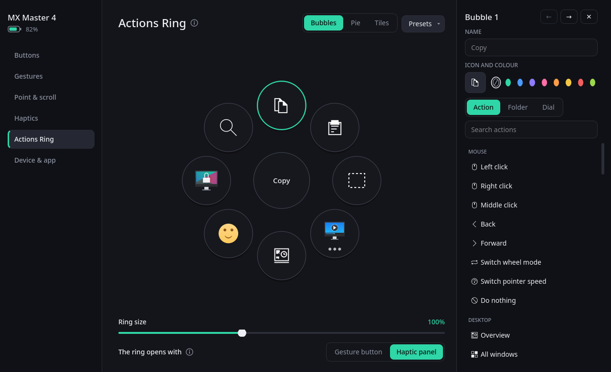
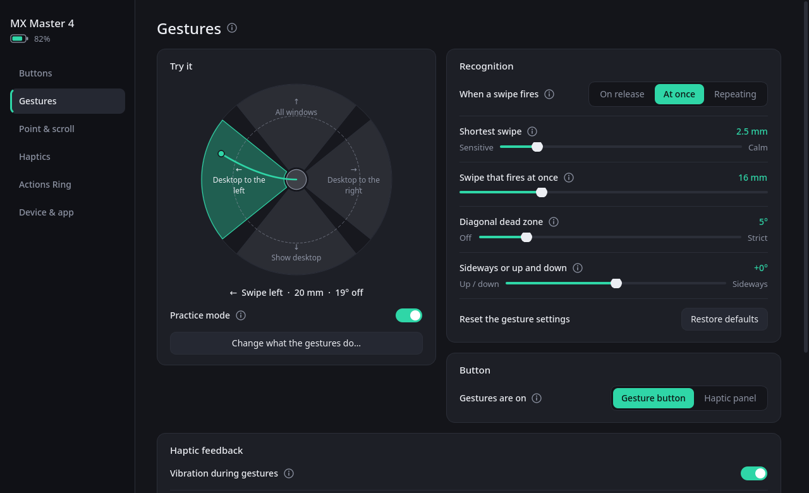
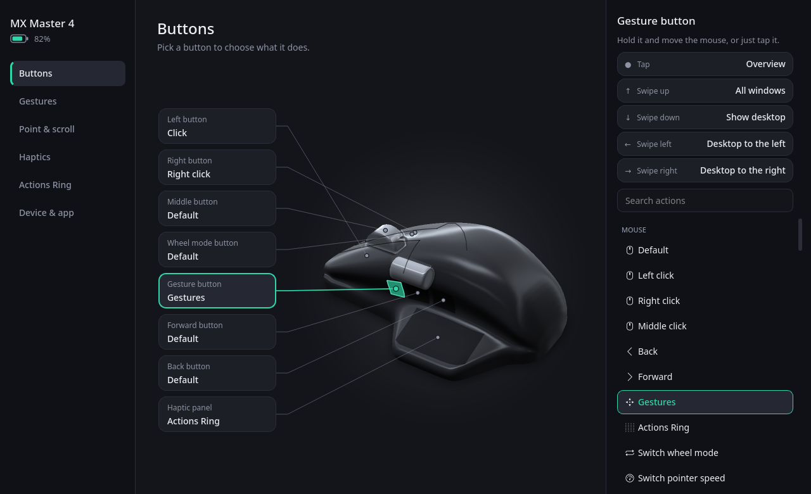
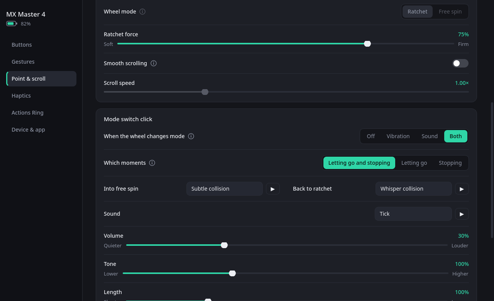
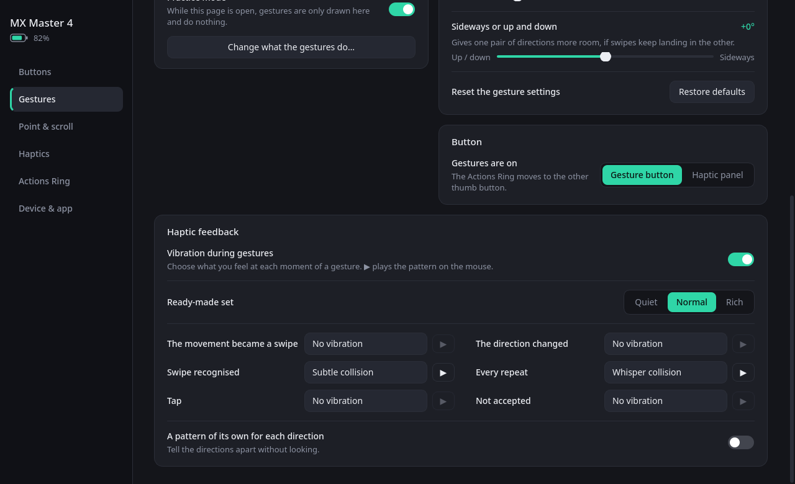

# MX Options

A settings app for Logitech MX Master mice on Linux, in the spirit of Logi Options+: buttons,
gestures, the Actions Ring, the wheels, haptics and Easy-Switch, with a tray icon, a background
service and a D-Bus API for other programs.

[Українською](README.uk.md)

> **Written by an AI.** Every part of this project (the code, the interface, the sounds, the tests
> and this documentation) was written by [Claude](https://claude.com/claude-code), Anthropic's AI
> model, working in Claude Code. A human, [nictonus](https://github.com/nictonus), directed the work
> and tried each build on a real MX Master 4. Read the code with that in mind, and see
> [Known limits](#known-limits) for what has and has not been checked on hardware.

> **Unofficial.** Not affiliated with or endorsed by Logitech. "Logitech", "MX Master", "Logi
> Options+", "Easy-Switch" and "SmartShift" are trademarks of Logitech.



| | |
|---|---|
|  |  |
|  |  |

## What it does

- **Buttons.** Middle, back, forward, gesture, wheel-mode button and the haptic panel each take
  any of about 70 ready actions (each done the way your desktop does it), a keyboard shortcut, a
  command, a script, a macro, or a signal to another program. The mouse is drawn with the button you are pressing lit
  up.
- **Gestures.** Hold a button and swipe in four directions, or tap. A live compass shows how your
  movement is read. You choose when a swipe fires (on release, at once, or repeating as you keep
  moving), the distances in millimetres, a dead zone for diagonals, and a vibration pattern for each
  moment of a gesture. The same button also reads sixteen shapes drawn with it held (corners, there
  and back, circles, shakes), each with an action of its own. An app you added can give any button
  gestures of its own on the Buttons page, Pan and Zoom while held included; how swipes are read,
  the speed and the vibrations stay the same in every app. While you try gestures on the Gestures
  page, the app in front before MX Options counts, and the compass shows the gestures for all apps.
  Rotating is not offered.
- **Actions Ring.** A menu around the cursor, as bubbles, a pie or tiles. Bubbles run actions, open
  their own ring of bubbles (three levels deep), or are *dials* that you turn with the wheel or the
  thumb wheel without closing the menu: volume, tabs, zoom, undo, tracks and more. The cursor stays
  free while the ring is open. Presets are included and your own can be saved.
- **Spotlight effects.** Hold a button and an effect follows the pointer until you let go:
  *Highlight* darkens the screen around a clear circle, *Digital Laser* is a coloured dot, and *Still
  Magnify* enlarges a still picture of the screen taken when you pressed (this program's own kind
  of magnifier, not a live one). Each has its size and colour; with more than one switched on,
  double-click and hold for the next. Buttons for all apps only, for now; see [Known limits](#known-limits).
- **Wheels.** Pointer speed (two speeds and a precision speed), SmartShift and its threshold,
  ratchet force, natural direction, high-resolution scrolling, and what the thumb wheel does. An
  optional click, felt or heard, marks SmartShift letting the wheel go and catching it again.
- **Haptics.** Strength, the built-in patterns, and how hard the thumb panel has to be pressed.
  Rumble from games can be played on the mouse: see [Rumble from games](#rumble-from-games).
- **Flow.** One mouse on two or three computers: push the pointer past the edge of the screen and
  the mouse carries on on the computer behind it, with the text, pictures and files you copied.
  They are paired with a six-digit code and talk over an encrypted link. See [Flow](#flow).
- **Keyboard.** A Logitech keyboard that speaks HID++ 2.0 (MX Mechanical, MX Keys and the like) is
  found next to the mouse, on the same receiver or over Bluetooth, and shows up under it in the
  sidebar: its programmable keys take the same kinds of actions as the buttons, Easy-Switch from a
  key moves the keyboard, and its battery, channels and firmware are shown. A key you have not
  changed is left to the keyboard. Up to 32 apps can have keys of their own, which count while the
  app is in front (not on GNOME with Wayland, which does not say which app that is). Not tried on a
  real keyboard yet: see [Known limits](#known-limits).
- **Also:** Easy-Switch between computers, a tray icon in five styles (plain ones in the colour of
  your panel that show a missing mouse and a low battery, one that fills with the charge), firmware
  versions with an update check through fwupd, four themes with any accent colour, English and
  Ukrainian. All settings can be exported to a file and imported again: see [Files](#files).
- **For other programs:** a [D-Bus API](docs/API.md) to play vibrations, run actions, show a ring of
  their own, change settings, and follow buttons, gestures and the wheel.

## Requirements

Developed and tested on **KDE Plasma 6 (Wayland)**, on an Arch-based distribution, with an **MX
Master 4**, on a Bolt receiver and over Bluetooth.

Other Logitech mice that speak HID++ 2.0 are taken as they are: the app offers what the mouse
reports it has (its buttons, SmartShift old or new, thumb wheel, battery) and hides the rest. The
MX Masters before the 4 (3S, 3, 2S and the first) are drawn with the 3D model, any other mouse
with a plain drawing of its own buttons. None of these was tried by the author; a user reported
gestures working on a Signature M650 L.

- Python 3.12 or newer (3.13 or newer for Flow)
- PySide6 (Qt 6.6 or newer), with Qt Declarative and Qt Multimedia
- python-evdev
- layer-shell-qt (its QML module draws the ring over other windows on Wayland; a small library, not a
  desktop: it is wanted on sway and Hyprland as much as on KDE Plasma)
- numpy, optional: the glossy 3D model and soft shadows
- for what was copied to cross with Flow, optional: KGuiAddons with its Python bindings (KDE
  Frameworks 6), or wl-clipboard. On X11 neither is needed.

Use your distribution's PySide6. One installed with pip brings its own Qt, which cannot see the
system's layer-shell module, so the Actions Ring would not appear.

| Distribution | Packages |
|---|---|
| Arch, CachyOS, Manjaro | `pyside6 python-evdev qt6-declarative qt6-multimedia layer-shell-qt python-numpy kguiaddons` |
| Debian 13, Ubuntu 25.04 and newer | `python3-evdev python3-numpy qml6-module-qtquick qml6-module-qtquick-window qml6-module-org-kde-layershell liblayershellqtinterface6` and `python3-pyside6.qtcore`, `.qtgui`, `.qtwidgets`, `.qtdbus`, `.qtnetwork`, `.qtsvg`, `.qtqml`, `.qtquick`, `.qtmultimedia` |
| Fedora | `python3-pyside6 python3-evdev qt6-qtdeclarative qt6-qtmultimedia qt6-qtsvg layer-shell-qt python3-numpy` |

Older Ubuntu releases (24.04 and before) have no PySide6 package.

### Desktops

What talks to the mouse (buttons, gestures, the wheels, pointer speed, haptics, Easy-Switch, game
rumble) does not depend on the desktop. What talks to the desktop does, and is done in the way
each desktop allows:

| | KDE Plasma | sway, Hyprland and other compositors with layer-shell | GNOME on Wayland | X11 desktops (Xfce, Cinnamon, MATE, i3, …) |
|---|---|---|---|---|
| Ready actions for windows and the desktop | KDE's own shortcuts: all of them | `swaymsg`, `hyprctl`; a launcher, screenshots and a terminal from what is installed (fuzzel, wofi, rofi; grim and slurp) | GNOME's key combinations as it ships them | the usual key combinations (Alt+F4, Ctrl+Alt+arrows, Print, …) |
| Actions Ring | on a layer above the windows | the same | in a window on the session's X server (XWayland), which takes no focus; a little soft where the display is scaled by a fraction | in a window the window manager leaves alone; as a panel of the ring's size where nothing composites |
| Spotlight effects | Highlight and Digital Laser, on the layer above the windows | the same | Highlight and Digital Laser, in the XWayland window | all three, where something composites; none where nothing does |
| Flow: the screen edge | a KWin script | a see-through line one pixel wide along the edge | not possible: use the *Move to the other computer (Flow)* action | the pointer's position is asked for |
| Haptics: a tick on switching screens | the same KWin script | not possible | not possible | the pointer's position is asked for |
| Flow: what was copied | KGuiAddons, else wl-clipboard | the same | wl-clipboard | Qt itself |

An action a desktop has no way of doing is not offered there, and settings made on KDE keep working:
*Overview* stays *Overview*, done as the desktop at hand does it. The key combinations are the
ones a desktop comes with; one you have rebound will not do its job, and then a keyboard shortcut of
your own in its place will.

**What was actually run.** Only KDE Plasma 6 on Wayland is used day to day. The X11 ways (the ring's
window, the pointer watching, full-screen detection, the clipboard) were run in a virtual X server
with no window manager. The line along the edge was run on KWin, where it hears the pointer and
passes clicks and scrolling on, and so was the ring through XWayland, which there comes up over
everything, is picked from and leaves the focus where it was. Nothing at all was run on GNOME,
sway, Hyprland or any X11 desktop itself: their commands and key combinations come from their
documentation. Reports are welcome.

On GNOME the ring is drawn by a small second program (it has to talk to the X server, which the
main one, a Wayland program, cannot). Where the session keeps no X server the ring falls back to an
ordinary window, which takes the focus while it is open.

`MXOPTIONS_DESKTOP` (`kde`, `gnome`, `sway`, `hyprland`, `other`), `MXOPTIONS_RING` (`layer`, `x11`,
`xwayland`, `window`), `MXOPTIONS_FLOW_EDGES` (`kwin`, `poll`, `strips`, `none`) and `MXOPTIONS_CLIPBOARD`
(`ksystem`, `qt`, `wl-clipboard`, `klipper`, `none`) override what the program works out for
itself, should it get one of them wrong.

## Windows

The program also runs on Windows (11 was tried, 10 was not). `python tools\build_windows.py` (with Python 3.13,
`pip install PySide6 numpy pyinstaller`, and Inno Setup for the last of the three) makes a folder
with `mxoptions.exe`, a zip of it, and an installer, `mxoptions-<version>-setup.exe`. The installer
puts the program into the user's own program folder, asks for no administrator, adds a Start menu
entry and, if wanted, starts the program at sign-in; it also updates and removes it. Neither the
program nor the installer is signed, so Windows asks before running them the first time. From the
source tree the program runs as `pythonw main.py`.

**Logi Options+ has to be out of the way**, or the two undo each other's settings of the mouse. Its
agent is started again by its service whenever it is closed, so both have to go, from an
administrator's PowerShell (until the next start of Windows, or for good by uninstalling it):

```powershell
Stop-Service OptionsPlusUpdaterService; Stop-Process -Name logioptionsplus_agent, logioptionsplus_appbroker -Force
```

MX Options says so in its window when it finds Options+ running.

What was run on Windows 11 with the mouse on Bluetooth, driven from another computer with nobody
at the mouse:

- the program, both from the tree and built, finds the mouse and reads and sets its battery,
  pointer speed, wheel mode, vibration and Easy-Switch channel;
- keys, text, clicks and scrolling are sent, the ready actions with Windows' own key combinations;
- the Actions Ring opens at the pointer, is picked from, and leaves the keyboard where it was;
- the settings window draws as on Linux, with Windows' own icon font standing in for icon names
  Windows lacks;
- Flow with a Linux computer, by the *Move to the other computer* action: the mouse goes across and
  back, and with it text, files and folders (names Windows cannot write are changed as little as
  will do). A computer with both systems keeps one pairing for the two;
- the mouse's own movement, buttons and wheel are read (through raw input) and told apart from
  other pointing devices, which is what crossing at the screen edge and the click of the wheel
  changing mode by itself go by;
- the screen brightness actions set the laptop's own panel through its display driver, and monitors
  that take it over their cable (the panel was tried, such a monitor was not);
- the installer installs, updates over a running copy, and lists the program among the installed
  ones; "Start at login" writes and removes its entry;
- `mxoptions --call` stands in for the D-Bus interface, which Windows does not have.

**Game rumble needs a driver on Windows.** Windows lets a program add a game controller only through
a driver made for that; the one used is [ViGEmBus](https://github.com/nefarius/ViGEmBus/releases),
which you install once (it is no longer developed, and still the one such tools use). The Windows
build carries its client library (ViGEmClient.dll, MIT licence, fetched and checked when the build is
made). Without the driver the settings say so. With ViGEmBus 1.22.0 it was run with a test program
standing in for a game: what that sent to the controller's motors through XInput was played on the
mouse. No game itself was tried.

Used by hand on Windows: the buttons, gestures, the wheels, the Actions Ring, and crossing at the screen
edge to a Linux computer and back. Not tried: the Bolt receiver (written, never plugged in there), the
tick on switching screens, and game rumble in a game itself.
Not there yet: letting Flow be found by other computers (Windows' firewall asks about that; the
Windows side calls the other computer itself, which needs no permission).

## Installing

### Arch Linux and derivatives

Download the package from the [latest release](https://github.com/nictonus/mxoptions/releases/latest)
and install it:

```sh
sudo pacman -U mxoptions-*-any.pkg.tar.zst
systemctl --user enable --now mxoptions.service
```

Or build the same package yourself:

```sh
git clone https://github.com/nictonus/mxoptions.git && cd mxoptions/packaging/aur
makepkg -si
```

### Debian and Ubuntu

Download the `.deb` from the [releases](https://github.com/nictonus/mxoptions/releases) and
install it; apt fetches what it depends on:

```sh
sudo apt install ./mxoptions_*_all.deb
systemctl --user enable --now mxoptions.service
```

Or build the same package from the source tree, on any system that has Python: `make deb`.

### Fedora

There is a spec file, `packaging/rpm/mxoptions.spec`, to build the package with `rpmbuild` (its
first lines say how). Or install the packages listed above and use `make install-user` below.

The Debian package and the spec were made on Arch from the lists of packages those
distributions publish. Neither has been installed on its distribution by the author yet: please
report what does not fit. `make deb-test` and `make rpm` do that trial: they fetch the official
Debian or Fedora image, enter it without root or a container engine (`tools/distro.py`), install
the package with its dependencies and run the tests there. They download a few hundred megabytes.

### NixOS and other Nix systems

The flake builds the program with the distribution's PySide6, so the Actions Ring can use the
system's layer-shell module. It also brings the udev rules, the desktop entry, the icon and a
systemd user service.

From a checkout, with flakes enabled:

```sh
nix run .#              # start it without installing
nix build .#            # ./result/bin/mxoptions
nix develop             # dependencies for running the tests and the program
```

On NixOS, add the flake as an input and import its module:

```nix
{
  inputs.mxoptions.url = "github:nictonus/mxoptions";  # or a path:/local/checkout
  inputs.mxoptions.inputs.nixpkgs.follows = "nixpkgs";

  # ...
  imports = [ inputs.mxoptions.nixosModules.default ];
  services.mxoptions.enable = true;
}
```

The module installs the package and its udev rules and starts a systemd *user* service with the
graphical session. `services.mxoptions.fwupd = true;` puts `fwupdmgr` on the program's PATH for the
firmware page (fwupd itself is still enabled with `services.fwupd.enable = true;`). To leave out the
optional numpy and the glossy 3D model:

```nix
services.mxoptions.package =
  inputs.mxoptions.packages.${pkgs.stdenv.hostPlatform.system}.mxoptions.override { withNumpy = false; };
```

### Windows

Take `mxoptions-<version>-setup.exe` from the [releases](https://github.com/nictonus/mxoptions/releases)
and run it; it installs for your user and asks for no administrator. It is not signed, so Windows
asks before running it ("More info", then "Run anyway"). Close Logi Options+ first, as set out under
[Windows](#windows), which also says what does and does not work there yet.

### Any distribution, for your user only (no root)

Install the requirements above, then:

```sh
git clone https://github.com/nictonus/mxoptions.git && cd mxoptions
make install-user     # into ~/.local
make enable           # start now and at every login
```

If the app then reports that it cannot find or reach the mouse, see [Permissions](#permissions).

### Any distribution, for all users

```sh
sudo make install     # into /usr/local, device access rules included
sudo make udev        # apply those rules now, without replugging the receiver
systemctl --user enable --now mxoptions.service
```

### Without installing

```sh
python3 main.py
```

## Running as a service

An installation brings a systemd *user* service, `mxoptions.service`, tied to your graphical
session. It keeps the mouse configured in the background; the window is opened from the
application menu or the tray icon.

```sh
systemctl --user status mxoptions      # is it running, has it found the mouse
journalctl --user -u mxoptions -f      # its log
systemctl --user restart mxoptions
systemctl --user disable --now mxoptions
```

"Start at login" in the app's settings switches the same service on and off. Quitting from the tray
stops the service until the next login; while it is stopped the mouse behaves as it does without
any software.

The service starts with systemd's `graphical-session.target`. KDE Plasma and GNOME reach it by
themselves. A compositor started on its own (sway, Hyprland, a window manager from `.xinitrc`)
does not, unless you have set that up; there, start the program from the compositor's own
configuration instead:

```
exec mxoptions --background          # sway, i3
exec-once = mxoptions --background   # Hyprland
```

Without a system tray the program has nowhere to sit behind its window: started in the background
it still runs, and starting it again from the menu opens the window.

## Permissions

The app talks to the mouse through its `hidraw` device and sends key presses, clicks and scrolling
through `/dev/uinput`. Neither is open to ordinary users by default. `data/70-mxoptions.rules.in`
grants both to whoever is logged in at the computer. A Bluetooth mouse that appears before BlueZ
has read its vendor (the IDs are still 0000) gets access only when its report descriptor
describes a HID++ mouse and no keyboard:

```sh
sudo make udev
```

The Arch package and `sudo make install` already include the rules. Many systems have equivalent
rules from Solaar, Steam or KDE Connect, in which case nothing more is needed.

## Other mouse software

Stop **logid** (logiops) and **Solaar** before using MX Options. Two programs redirecting the same
buttons undo each other's settings.

```sh
sudo systemctl disable --now logid
```

## Flow

Flow moves the mouse between computers when the pointer is pushed past the edge of the screen, the
way Logitech's own Flow does, and takes along what you copied: text, pictures, files and folders.
It is this project's own implementation: it works between computers running MX Options, not with
Logi Options+. A computer can have another one on two of its sides, so three in a row share one
mouse (it has three Easy-Switch channels).

What it needs:

- MX Options running on every one of them, on the same network;
- the mouse paired with each, on an Easy-Switch channel of its own (Bolt receiver or Bluetooth);
- a desktop that lets the pointer be watched at the screen edge: all but GNOME on Wayland do (see
  [Desktops](#desktops)). There, and wherever you prefer it, a button, a gesture or a ring bubble
  with the action *Move to the other computer (Flow)* takes the place of the edge;
- for what you copied to cross: KGuiAddons with its Python bindings or wl-clipboard on Wayland,
  nothing more on X11.

Setting it up, on the *Flow* page:

1. On one computer press *Show a code*. It shows six digits.
2. On the other, open the same page. It finds the first computer by itself and asks for the code.
3. On the picture, click where the other computer stands. The other one takes the facing side by
   itself. For a third computer, repeat steps 1 and 2 with it and the one in the middle.
4. Use the mouse on each computer once (switch with the Easy-Switch button), so that both learn
   their channel. From then on, cross at the edge.

What can be tuned there:

- **Push past the edge:** how many millimetres the mouse has to keep moving once the pointer is at
  the edge, measured on the mouse itself. At 0 a touch is enough.
- **Keep the corners free:** the share of the edge, at each end, that does not lead across, so that
  hot corners keep working.
- **Full-screen windows:** by default a game or a film in full screen keeps the mouse.
- **Only while Ctrl is held:** off by default. On, the edge sends the mouse across only while
  either Ctrl key is held; the action *Move to the other computer (Flow)* and the Easy-Switch
  buttons do not need it. Works on X11 and Windows (Windows written from Microsoft's
  documentation, not yet tried on a Windows computer). A Wayland desktop does not tell a program
  in the background whether Ctrl is held, so there the edge keeps the mouse while it is on; the
  action still works. Older versions of MX Options ignore it and cross without Ctrl.
- **What goes along:** text and pictures, files and folders, and the largest amount to send in one
  go. Files are sent when you cross and wait in `~/.cache/mxoptions/flow-files` for a day. The
  clipboard of the computer you arrive on is left as it is until all of them are there; then they
  take it over, and the mouse gives a vibration of your choice (another one if they could not be
  brought over). The Flow page shows how far a transfer is and can cancel it.
- **Pausing one computer:** the switch next to *Forget* takes a paired computer out of Flow for a
  while and keeps the pairing and its place. Paused, the link to it is down: the mouse does not
  cross to it or back, nothing copied goes along, the keyboard does not follow, and files on their
  way stop. A switch already under way when you pause still finishes. The Easy-Switch buttons still
  reach it. Switch it on to resume. The other computer sees it as not connected.

How it works, and how it is kept private:

- **Pairing.** The six digits are never sent. The two computers run SRP-6a (RFC 5054, 3072-bit
  group, SHA-256), a password-authenticated key exchange: somebody listening or sitting in between
  gets nothing to try codes against, a wrong code costs one of three tries, and the code is good
  for two minutes and one computer. Both sides end up with the same 120-bit key.
- **The link.** Everything afterwards travels over TLS 1.2 with that key (ECDHE-PSK, so a recording
  of the traffic stays unreadable even to someone who later learns the key).
- **Finding each other.** Small UDP broadcasts on the local network: a computer showing a code says
  so, and two paired computers that lost each other (an address changed) call out, signed with
  their key. No address has to be typed.
- **Ports.** TCP 47846 for the link (`flow.port` in the settings file), UDP 47846 for finding each
  other, TCP 47847 only while a code is on show. Open them in the firewall for the other computer.
- **Crossing.** The computer that has the mouse tells it to change channel over HID++, then tells
  the other one where the pointer left and what is on the clipboard. The other computer puts its
  pointer at the matching place of the facing edge.

The mouse is only sent away when the link is up and the other computer has reported its channel, so
it does not end up on a computer that is switched off. It is not sent while a button is held or
when a touchpad or another mouse moved the pointer to the edge. If it ever does end up on the wrong
channel, the Easy-Switch button on its underside brings it back.

How long crossing takes is mostly the mouse changing its radio channel: about half a second to a
computer with a Bolt receiver, one to two seconds to one on Bluetooth. Flow links computers that
run MX Options; it does not talk to Logi Options+ on Windows or macOS.

**Mouse follows the keyboard** (off by default; the switch shows once a keyboard was found). Press
the keyboard's own Easy-Switch key for one of the other computers, and once that computer reports
the keyboard has arrived, the mouse is sent there too. This is MX Options Flow, between computers
that run MX Options and see the keyboard; it is not Logitech Flow or the Enhanced Easy-Switch of
Logi Options+, and neither of those is asked. This switch only ever moves the mouse; the one below
moves the keyboard. The mouse goes only within 10 seconds of the keyboard leaving, once each time it
leaves, not while a button is held, and not when an action of this app sent the keyboard away. Each
pairing names the keyboard with a value of its own made from the pairing key; which keyboard it is
never leaves the computer.

**Keyboard follows the mouse** (off by default; the switch shows once a keyboard was found). Send
the mouse to one of the other computers, past the edge or with the action, and the keyboard is sent
there too, to the Easy-Switch channel that computer saw it on. It goes once each time the mouse
leaves, and only when the keyboard is here, the other computer saw this same keyboard since it
started and the keyboard is paired there, the keyboard itself says that channel is paired, and no
key is held down. Whether a key is down is asked of the keyboard just before it goes, through the
connection the app already has: the answer is reduced to one yes or no at once, and nothing of it
is kept, logged or sent. Otherwise the keyboard stays, and the log says why ("the keyboard stays";
see `journalctl --user -u mxoptions`). It is never tried again for that crossing.

It can only start from Linux with the keyboard on Bluetooth (BlueZ). A keyboard on a receiver or a
cable stays, and so does one that reports anything but keys (letters, media and system keys) and
its HID++ messages. Windows can receive the keyboard but cannot send it onward automatically: there,
press the keyboard's Easy-Switch key. The computer the mouse goes to needs this version too, to say
where the keyboard goes; with an older one the keyboard stays. The keyboard's own Easy-Switch keys
always work, and switching this off or stopping the app (`systemctl --user stop mxoptions`) stops it.

For networks where the computers cannot find each other, the address and the key can be entered by
hand at the bottom of the page.

## Rumble from games

Games vibrate game controllers, not mice. With *Haptics → Game rumble* switched on, the app adds a
virtual gamepad to the system (it shows up as an Xbox 360 controller named "MX Options rumble
pad"). The rumble a game sends to it, through SDL, Steam Input or Proton, is played on the mouse's
haptic motor.

- The motor plays short patterns, not a continuous hum, so a rumble becomes a row of pulses: one
  pattern each for weak, medium and strong rumble, a chosen time apart.
- A game then sees a controller. Some show gamepad prompts because of it, and some only vibrate a
  controller that is actually being played with, in which case nothing reaches the mouse. Switch
  the option off if a game misbehaves; the virtual gamepad is gone at once.
- `journalctl --user -u mxoptions -f` shows "a game started vibrating" whenever rumble arrives,
  which tells whether a game sends any.

It needs a mouse with a haptic motor (the MX Master 4).

## The picture of the mouse

The Buttons page can show Logitech's own render of the MX Master 4, in three body colours. Those
pictures belong to Logitech and are not part of this repository: the app downloads them from
logitech.com when you press *Download* and keeps them in `~/.local/share/mxoptions/mouse`. Until
then, and for other mice, it draws its own 3D model.

## Files

| | |
|---|---|
| Settings | `~/.config/mxoptions/config.json` |
| Settings as they were before the last import | `~/.config/mxoptions/config.backup.json` |
| Keyboard keys the app has changed (to give them back after a crash) | `~/.local/share/mxoptions/keyboard-diverted.json` |
| Mouse pictures | `~/.local/share/mxoptions/mouse/` |
| Generated click sounds | `~/.cache/mxoptions/sounds/` |
| Files that arrived through Flow | `~/.cache/mxoptions/flow-files/` |
| Tray icon drawings | `~/.local/share/icons/hicolor/scalable/status/mxoptions-tray-*.svg` |

*Device & app → Settings file* exports every setting to a file of up to 1 MB, and imports one. The
file holds your commands and scripts too, so keep it private; the pairings of Flow (their keys, what
this computer goes by, its channel) are never in it, and an import keeps the ones this computer has.
An import first keeps the settings in use, unsaved changes included, in `config.backup.json`, saves
the new ones, and only then uses them; when it cannot do all of that, it uses none. To go back,
quit the app and copy `config.backup.json` over `config.json`.

The macro editor exports one macro to a file of its own (*Export…*) and imports one (*Import…*). The
format is this app's own, not a file of Logitech Options+. An import only fills the editor: nothing
runs, and nothing is kept until *Save*. A file that is not exactly a macro the editor can show is
refused whole. The file holds the macro's text and commands as written: keep it private, and import
only files you trust.

## Known limits

- **Left and right buttons cannot be reassigned.** The mouse does not let software take them over.
- **SmartShift's own switching is inferred.** The mouse announces a mode change made with the
  button, not the one SmartShift makes at speed, so the app works that out from how fast the wheel
  turns. The click can be a notch or two away from the real moment.
- **Text in macros is pasted.** It goes through the clipboard and Ctrl+V, so it does not work in
  terminals.
- **Smooth scrolling passes through the app.** With it on, the wheel only scrolls while the app
  runs.
- **There is no firmware to update to.** The app shows the firmware versions and asks fwupd, the
  system's firmware updater, for updates. fwupd can flash both the mouse and the Bolt receiver, but
  Logitech has published no firmware for either of them for Linux, so the check finds nothing. The
  app does not flash anything itself.
- **The mouse following the keyboard was not tried on real devices.** Only tests with made-up
  computers and keyboards cover it. If the other computer reports the keyboard before this one
  notices it has gone, the mouse stays; how often that happens is not known yet.
- **The keyboard following the mouse was not tried on a real keyboard.** Only tests with made-up
  keyboards and computers cover it; whether a real keyboard reports a key held down correctly over
  Bluetooth is not known yet. A key pressed in the very moment the keyboard switches can stay down
  on the computer it left, repeating, until the keyboard is back there or the key is pressed again.
  If the keyboard was paired anew since the other computer last saw it, it can land on a third
  computer; its Easy-Switch key brings it back. Each check reads the keyboard over Bluetooth, and
  bluetoothd keeps a copy of every read (about 8.5 KiB each) while the keyboard stays connected and
  replays them when it reconnects: so the app reads a keyboard at most 32 times each time it opens
  it, and starts counting again after a restart. With `UserspaceHID=persist` in
  `/etc/bluetooth/input.conf` those copies outlast disconnects until bluetoothd restarts. While a
  check waits for the keyboard's answer, other programs opening or closing a HID device may wait
  too, rarely up to 5 seconds.
- **Flow with three computers was never run on three.** It was written with two at hand: the
  tests put three copies of the program on one machine and cross between them, but no third
  computer has received the mouse.
- **Game rumble was not tried in a game.** A test program playing rumble on the virtual gamepad
  makes the mouse vibrate on time; which games send rumble to it has not been explored.
- **Run on one desktop.** KDE Plasma on Wayland is where the program is used. What it does on other
  desktops is set out under [Desktops](#desktops), with what was and was not run there. On
  compositors where a line along the edge watches for Flow, a drag that starts on that very line
  of pixels (a scroll bar at the edge of the screen) does not start; a click and scrolling there
  are passed on.
- **Checked on one mouse.** Everything was tried on a single MX Master 4. Synthetic tests cover the
  logic; the feel of gestures, vibrations and sounds was judged by one person.
- **The keyboard has not been tried on a keyboard.** That part was written from Logitech's published
  description of the protocol and is covered by tests with made-up devices only. What a real
  keyboard does with a diverted key after a crash, a power cycle or an Easy-Switch to a computer
  without MX Options has not been seen; until it has, treat the keyboard side as a preview.
- **One keyboard at a time.** A second one is ignored while the first is there.
- **Keys for single apps were not tried on a desktop.** Which app is in front is heard from KWin
  on KDE Plasma, from `swaymsg` on sway, from Hyprland's event socket, from the X server elsewhere
  on X11 (twice a second) and from Windows (twice a second); only tests with made-up desktops cover
  that. GNOME on Wayland does not say, so there the keys do what is set for all apps. The app is
  known by its window class (its program file on Windows), so two windows of one program share its
  keys, and a Hyprland class with a comma in it cannot be told. A key that changes when another app
  comes to the front lets go at once and its macros stop before their next step; a command one of
  them started keeps running. To add an app, switch to it, then come back to the Keys page.
- **Some keys stay the keyboard's.** The Easy-Switch keys and the keys of the Fn layer are never
  taken over, and the Fn mode, the backlight and the other settings of the keyboard itself are not
  offered yet. The Keyboard page lists the ones the keyboard says it has, in general words: that it
  has one does not say which keys or values it uses, and the app changes none of them.
- **The keyboard's firmware version is read from the keyboard** where fwupd does not show it, after
  its keys are set up. How it compares with the version Logitech's own software shows has not been
  checked on a real keyboard.
- **Changed keys go back when the app quits.** A key is changed with the keyboard's temporary
  setting, never the one it keeps for good. The app notes each key before it changes it, in the file listed
  under [Files](#files), and after a crash gives back what it finds still changed the next time it
  starts. Keys another program changed are left alone, and while Logi Options+, Solaar or logiops
  is running no key is touched at all. If that file cannot be read, nothing is touched either:
  move it away, and if a key then stays dead, switch the keyboard off and on once. An older version of MX Options ignores
  the keyboard settings and that file; quit this one before going back to it, so the keys are
  given back first. "Restore defaults" in an older version drops the keyboard settings.
- **Easy-Switch from a key gives the keys back first.** The keyboard is only sent to the other
  computer once every key the app changed is back to normal; if one cannot be given back, it stays
  here with its keys as set, and the Keyboard page says so. The keyboard's own Easy-Switch keys are
  the keyboard's: when they are used, the app is not asked.
- **Spotlight effects are a first part.** They are set for a button of all apps, not for a key or
  in an app profile. While one shows it covers the screen it is on (all screens with XWayland):
  clicks and scrolling there do nothing until the button comes up, the thumb wheel's scrolling and
  zooming included; keys and thumb wheel functions that send keys work as usual. Still Magnify shows
  the screen as it was at the press, kept in memory only (at most 64 MiB) and dropped on release;
  it is not offered on Wayland, where a program gets no picture of the screen without asking, and
  live magnifying is not done yet. Without a compositing manager on X11, and on Wayland desktops
  with neither layer-shell nor XWayland, there are no effects at all. No ring opens while a
  Spotlight button is held. None of this was tried on a desktop yet: tests with made-up screens and
  pictures cover it.
- **Suggested settings for an app are a first part.** On the Buttons page, an app you added can take
  one of three sets after Logi Options+: *Web browser* (middle, back and forward buttons as the
  mouse has them, thumb wheel switches tabs), *Spreadsheet* (back Ctrl+Z, forward Ctrl+Y, thumb
  wheel scrolls sideways) and *Documents and slides* (the same buttons, thumb wheel zooms). A set
  only changes what the app does as in all apps; a button or function it has of its own stays, and
  the dialog lists both before you apply. Logi Options+ also makes the middle button pan in the
  spreadsheet and document apps: these sets leave the middle button as it is (an app's middle button
  can be given Gestures with Pan by hand), and they leave out its sets for Photoshop, Premiere Pro,
  Final Cut Pro, Zoom and Teams and its rings for single apps. Nothing is matched by the app's name.
  Ctrl+Z and Ctrl+Y are key positions: on a layout where Z and Y trade places (German, for one) they
  trade places too.
  Two more sets are own choices, not after Logi Options+ (what its Zoom and Teams sets hold is not
  published): *Zoom meetings* (Linux and Windows: back Alt+A, mute or unmute, forward Alt+V, video
  on or off, Zoom's default shortcuts in a meeting) and, on Windows only, *Microsoft Teams meetings*
  (Ctrl+Shift+M and Ctrl+Shift+O of the Teams desktop app; Teams has no desktop app for Linux, and
  its web app has no video shortcut). They touch the back and forward buttons only. Each press sends the
  shortcut once, however long the button is held, and only while that app is in front. Like any
  macro, it waits for a macro still playing; at most four wait and a press past that is dropped, and
  changing what the button does or the mouse going away drops one still waiting. A shortcut changed
  in the app no longer matches. Keys are key positions: on French AZERTY Alt+A lands where Q is, and
  Microsoft lists its shortcuts for the US layout. These are the apps' own mute, not the system's
  *Mute microphone* (`mic_mute`), which stays a separate action. Not tried with the apps yet.
  On Windows there are two own sets more, *Photoshop* and *Premiere*. They are partial choices after
  Windows shortcuts Adobe documents, not the Logi Options+ sets for these apps named above: what
  those send is not known here, so they stay left out. *Photoshop*: back Ctrl+Z, forward
  Ctrl+Shift+Z, thumb wheel `]` turning up and `[` turning down, which Adobe names for the brush size
  of Pattern Stamp and Spot Healing Brush. *Premiere*: the same buttons, thumb wheel Page Down and
  Page Up: the next and previous screen of the Timeline, a whole screen per step, not smooth
  scrolling; Adobe says the pointer must be over the Timeline, and its list of shortcuts that the
  panel must have focus. Adobe makes these apps for Windows and macOS only, so other systems do not
  offer the two sets; what they set stays ordinary settings of the app everywhere. They give the
  thumb wheel keystrokes only where the app has none of its own and its thumb wheel sends keystrokes;
  keystrokes the app has of its own stay, and the dialog names them. Shortcuts changed in the app,
  another keyboard layout or Photoshop's "Use Legacy Undo Shortcuts" make them do something else.
  They were not tried with Photoshop or Premiere.
- **Photoshop actions on the ring (Windows), set up by you.** Photoshop plays a recorded action from
  a function key you give it. Record the action in its Actions panel (Layer > New Adjustment Layer >
  Brightness/Contrast, say), give it a Function Key such as Ctrl+Shift+F3, then give a bubble of
  Photoshop's own ring that key as a keyboard shortcut. Each press of the bubble plays the action
  once. This is your own setup with what the program already has, not a built-in Photoshop dial:
  turning a dial to change a value (brightness, saturation) cannot be done this way and is not done
  yet. No ring of F keys comes with the program: it cannot know which actions you recorded.
- **The haptic panel does not answer while a main button is held.** With the left button down the
  mouse reports nothing for the panel, however hard it is pressed; the gesture button is reported
  all the same. So gestures made while a window is being dragged want the gesture button, not the
  panel. This was read off what the mouse sends, with nothing of this program in between.

## Development

```sh
make test                                  # unit tests for the logic (no mouse needed)
python3 tools/check_i18n.py                # untranslated, unused and duplicated strings
python3 tools/screenshots.py /tmp/shots    # render every page without a mouse or a screen
```

| | |
|---|---|
| `mxoptions/hidpp.py`, `device.py` | HID++ 2.0 transport and the features of the mouse |
| `mxoptions/engine.py` | the worker thread: applies settings, turns buttons, wheels and gestures into actions |
| `mxoptions/actions.py`, `vinput.py` | the action catalogue, its executor, the virtual keyboard and mouse |
| `mxoptions/config.py` | the settings file: defaults, validation, migration, ring presets |
| `mxoptions/api.py` | the D-Bus interface |
| `mxoptions/rumble.py` | the virtual gamepad that games vibrate |
| `mxoptions/flow.py`, `flow_pairing.py`, `flow_files.py` | Flow: the link between two computers, pairing by code, copied files |
| `mxoptions/flow_service.py`, `clipboard.py` | Flow's ties to the mouse, the desktop and the clipboard |
| `mxoptions/ui/` | the settings window, the ring overlay, sounds |
| `data/` | desktop entry, systemd unit, udev rules |

## Uninstalling

```sh
make uninstall-user          # or: sudo make uninstall, or: sudo pacman -R mxoptions
rm -r ~/.config/mxoptions ~/.local/share/mxoptions ~/.cache/mxoptions    # settings and downloads
rm ~/.local/share/icons/hicolor/scalable/status/mxoptions-tray-*.svg     # the tray icon (after a system-wide install)
```

## Licence

[MIT](LICENSE).
