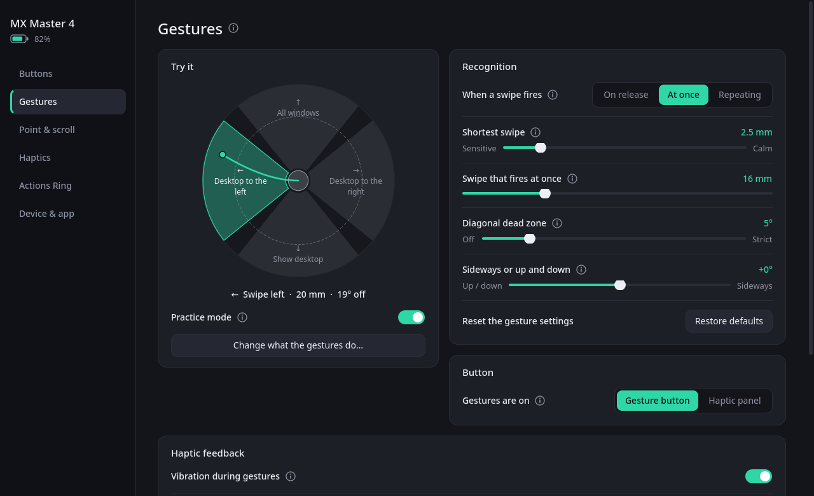
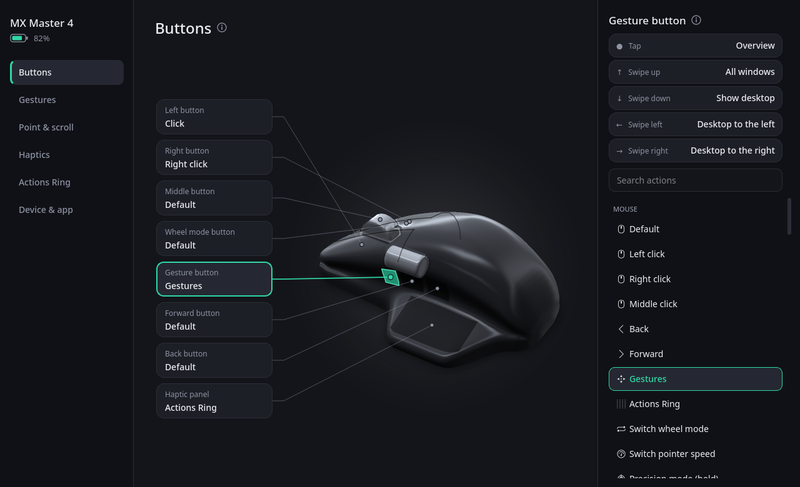
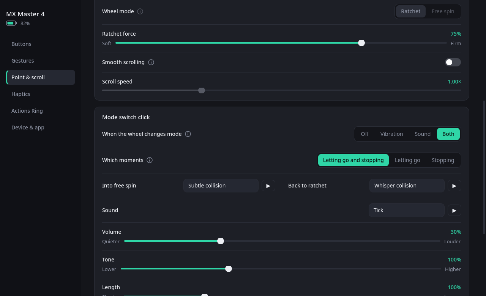
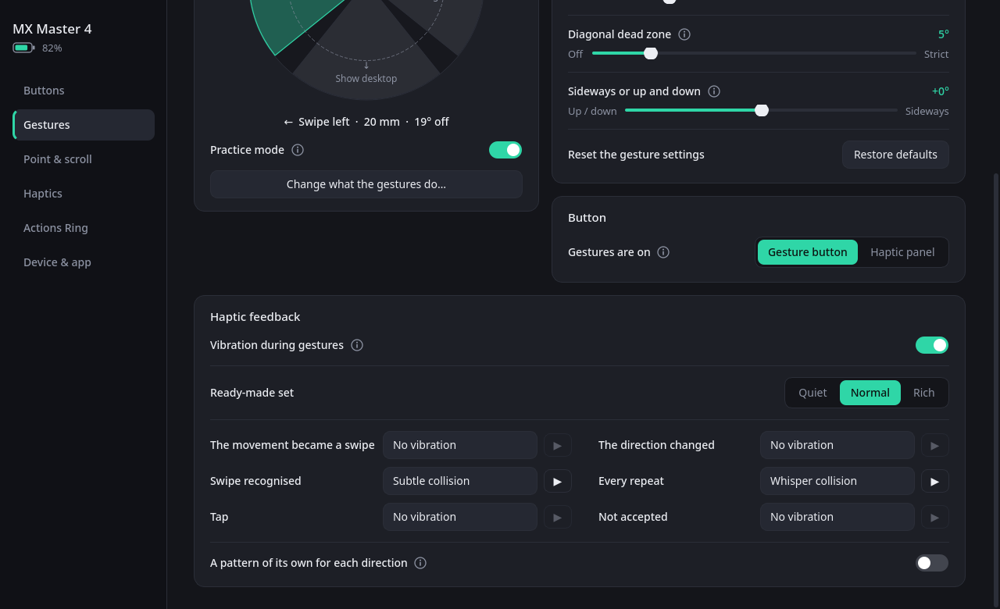

# MX Options

A settings app for Logitech MX Master mice on Linux, in the spirit of Logi Options+: buttons,
gestures, the Actions Ring, the wheels, haptics and Easy-Switch, with a tray icon, a background
service and a D-Bus API for other programs.

[Українською](README.uk.md)

> **Written by an AI.** Every part of this project (the code, the interface, the sounds, the tests
> and this documentation) was written by [Claude](https://claude.com/claude-code), Anthropic's AI
> model, working in Claude Code. A human, [nictonus](https://github.com/nictonus), directed the work
> and tried each build on a real MX Master 4. Read the code with that in mind, and see
> [Known limits](#known-limits) for what has and has not been checked on hardware.

> **Unofficial.** Not affiliated with or endorsed by Logitech. "Logitech", "MX Master", "Logi
> Options+", "Easy-Switch" and "SmartShift" are trademarks of Logitech.


| | |
|---|---|
|  |  |
|  |  |

## What it does

- **Buttons.** Middle, back, forward, gesture, wheel-mode button and the haptic panel each take
  any of about 70 ready actions, a keyboard shortcut, a KDE global shortcut, a command, a script,
  a macro, or a signal to another program. The mouse is drawn with the button you are pressing lit
  up.
- **Gestures.** Hold a button and swipe in four directions, or tap. A live compass shows how your
  movement is read. You choose when a swipe fires (on release, at once, or repeating as you keep
  moving), the distances in millimetres, a dead zone for diagonals, and a vibration pattern for each
  moment of a gesture.
- **Actions Ring.** A menu around the cursor, as bubbles, a pie or tiles. Bubbles run actions, open
  their own ring of bubbles (three levels deep), or are *dials* that you turn with the wheel or the
  thumb wheel without closing the menu: volume, tabs, zoom, undo, tracks and more. The cursor stays
  free while the ring is open. Presets are included and your own can be saved.
- **Wheels.** Pointer speed (two speeds and a precision speed), SmartShift and its threshold,
  ratchet force, natural direction, high-resolution scrolling, and what the thumb wheel does. An
  optional click, felt or heard, marks SmartShift letting the wheel go and catching it again.
- **Haptics.** Strength, the built-in patterns, and how hard the thumb panel has to be pressed.
- **Flow.** One mouse on two computers: push the pointer past the edge of the screen and the mouse
  carries on on the other computer, with the text, pictures and files you copied. The two are
  paired with a six-digit code and talk over an encrypted link. See [Flow](#flow).
- **Also:** Easy-Switch between computers, battery level in the tray, firmware versions with an
  update check through fwupd, four themes with any accent colour, English and Ukrainian.
- **For other programs:** a [D-Bus API](docs/API.md) to play vibrations, run actions, show a ring of
  their own, change settings, and follow buttons, gestures and the wheel.

## Requirements

Developed and tested on **KDE Plasma 6 (Wayland)**, on an Arch-based distribution, with an **MX
Master 4 on a Bolt receiver**. Other MX mice use the same protocol and should largely work, but
none has been tried.

- Python 3.12 or newer (3.13 or newer for Flow)
- PySide6 (Qt 6.6 or newer), with Qt Declarative and Qt Multimedia
- python-evdev
- layer-shell-qt (its QML module draws the ring over other windows)
- numpy, optional: the glossy 3D model and soft shadows
- KGuiAddons with its Python bindings (KDE Frameworks 6), optional: pictures and files in Flow

Use your distribution's PySide6. One installed with pip brings its own Qt, which cannot see the
system's layer-shell module, so the Actions Ring would not appear.

| Distribution | Packages |
|---|---|
| Arch, CachyOS, Manjaro | `pyside6 python-evdev qt6-declarative qt6-multimedia layer-shell-qt python-numpy kguiaddons` |

Outside KDE the mouse settings themselves work, but the ring needs a compositor with layer-shell,
and many ready actions are KDE shortcuts.

## Installing

### Arch Linux and derivatives

Download the package from the [latest release](https://github.com/nictonus/mxoptions/releases/latest)
and install it:

```sh
sudo pacman -U mxoptions-*-any.pkg.tar.zst
systemctl --user enable --now mxoptions.service
```

Or build the same package yourself:

```sh
git clone https://github.com/nictonus/mxoptions.git && cd mxoptions/packaging/aur
makepkg -si
```

### Any distribution, for your user only (no root)

Install the requirements above, then:

```sh
git clone https://github.com/nictonus/mxoptions.git && cd mxoptions
make install-user     # into ~/.local
make enable           # start now and at every login
```

If the app then reports that it cannot find or reach the mouse, see [Permissions](#permissions).

### Any distribution, for all users

```sh
sudo make install     # into /usr/local, device access rules included
sudo make udev        # apply those rules now, without replugging the receiver
systemctl --user enable --now mxoptions.service
```

### Without installing

```sh
python3 main.py
```

## Running as a service

An installation brings a systemd *user* service, `mxoptions.service`, tied to your graphical
session. It keeps the mouse configured in the background; the window is opened from the
application menu or the tray icon.

```sh
systemctl --user status mxoptions      # is it running, has it found the mouse
journalctl --user -u mxoptions -f      # its log
systemctl --user restart mxoptions
systemctl --user disable --now mxoptions
```

"Start at login" in the app's settings switches the same service on and off. Quitting from the tray
stops the service until the next login; while it is stopped the mouse behaves as it does without
any software.

## Permissions

The app talks to the mouse through its `hidraw` device and sends key presses, clicks and scrolling
through `/dev/uinput`. Neither is open to ordinary users by default. `data/70-mxoptions.rules`
grants both to whoever is logged in at the computer:

```sh
sudo make udev
```

The Arch package and `sudo make install` already include the rules. Many systems have equivalent
rules from Solaar, Steam or KDE Connect, in which case nothing more is needed.

## Other mouse software

Stop **logid** (logiops) and **Solaar** before using MX Options. Two programs redirecting the same
buttons undo each other's settings.

```sh
sudo systemctl disable --now logid
```

## Flow

Flow moves the mouse between two computers when the pointer is pushed past the edge of the screen,
the way Logitech's own Flow does, and takes along what you copied: text, pictures, files and
folders. It is this project's own implementation: it works between two computers running MX
Options, not with Logi Options+.

What it needs:

- MX Options running on both computers, on the same network;
- the mouse paired with both, on different Easy-Switch channels (Bolt receiver or Bluetooth);
- KDE Plasma for the screen edge and for pictures and files. On other desktops only text crosses,
  and a button, a gesture or a ring bubble with the action *Move to the other computer (Flow)*
  takes the place of the edge.

Setting it up, on the *Flow* page:

1. On one computer press *Show a code*. It shows six digits.
2. On the other, open the same page. It finds the first computer by itself and asks for the code.
3. On the picture, click where the other computer stands. The other one takes the facing side by
   itself.
4. Use the mouse on each computer once (switch with the Easy-Switch button), so that both learn
   their channel. From then on, cross at the edge.

What can be tuned there:

- **Push past the edge:** how many millimetres the mouse has to keep moving once the pointer is at
  the edge, measured on the mouse itself. At 0 a touch is enough.
- **Keep the corners free:** the share of the edge, at each end, that does not lead across, so that
  hot corners keep working.
- **Full-screen windows:** by default a game or a film in full screen keeps the mouse.
- **What goes along:** text and pictures, files and folders, and the largest amount to send in one
  go. Files are sent when you cross, wait in `~/.cache/mxoptions/flow-files` for a day, and are
  put on the clipboard of the computer you arrive on.

How it works, and how it is kept private:

- **Pairing.** The six digits are never sent. The two computers run SRP-6a (RFC 5054, 3072-bit
  group, SHA-256), a password-authenticated key exchange: somebody listening or sitting in between
  gets nothing to try codes against, a wrong code costs one of three tries, and the code is good
  for two minutes and one computer. Both sides end up with the same 120-bit key.
- **The link.** Everything afterwards travels over TLS 1.2 with that key (ECDHE-PSK, so a recording
  of the traffic stays unreadable even to someone who later learns the key).
- **Finding each other.** Small UDP broadcasts on the local network: a computer showing a code says
  so, and two paired computers that lost each other (an address changed) call out, signed with
  their key. No address has to be typed.
- **Ports.** TCP 47846 for the link (`flow.port` in the settings file), UDP 47846 for finding each
  other, TCP 47847 only while a code is on show. Open them in the firewall for the other computer.
- **Crossing.** The computer that has the mouse tells it to change channel over HID++, then tells
  the other one where the pointer left and what is on the clipboard. The other computer puts its
  pointer at the matching place of the facing edge.

The mouse is only sent away when the link is up and the other computer has reported its channel, so
it does not end up on a computer that is switched off. It is not sent while a button is held or
when a touchpad or another mouse moved the pointer to the edge. If it ever does end up on the wrong
channel, the Easy-Switch button on its underside brings it back.

A keyboard does not follow unless it is switched by other means. For networks where the computers
cannot find each other, the address and the key can be entered by hand at the bottom of the page.

## The picture of the mouse

The Buttons page can show Logitech's own render of the MX Master 4, in three body colours. Those
pictures belong to Logitech and are not part of this repository: the app downloads them from
logitech.com when you press *Download* and keeps them in `~/.local/share/mxoptions/mouse`. Until
then, and for other mice, it draws its own 3D model.

## Files

| | |
|---|---|
| Settings | `~/.config/mxoptions/config.json` |
| Mouse pictures | `~/.local/share/mxoptions/mouse/` |
| Generated click sounds | `~/.cache/mxoptions/sounds/` |
| Files that arrived through Flow | `~/.cache/mxoptions/flow-files/` |

## Known limits

- **Left and right buttons cannot be reassigned.** The mouse does not let software take them over.
- **SmartShift's own switching is inferred.** The mouse announces a mode change made with the
  button, not the one SmartShift makes at speed, so the app works that out from how fast the wheel
  turns. The click can be a notch or two away from the real moment.
- **Text in macros is pasted.** It goes through the clipboard and Ctrl+V, so it does not work in
  terminals.
- **Smooth scrolling passes through the app.** With it on, the wheel only scrolls while the app
  runs.
- **There is no firmware to update to.** The app shows the firmware versions and asks fwupd, the
  system's firmware updater, for updates. fwupd can flash both the mouse and the Bolt receiver, but
  Logitech has published no firmware for either of them for Linux, so the check finds nothing. The
  app does not flash anything itself.
- **Checked on one mouse.** Everything was tried on a single MX Master 4. Synthetic tests cover the
  logic; the feel of gestures, vibrations and sounds was judged by one person.
- **One open question:** the haptic panel may not register while the left button is held down. If
  so that is the mouse's doing; it has not been confirmed either way.

## Development

```sh
make test                                  # unit tests for the logic (no mouse needed)
python3 tools/check_i18n.py                # untranslated, unused and duplicated strings
python3 tools/screenshots.py /tmp/shots    # render every page without a mouse or a screen
```

| | |
|---|---|
| `mxoptions/hidpp.py`, `device.py` | HID++ 2.0 transport and the features of the mouse |
| `mxoptions/engine.py` | the worker thread: applies settings, turns buttons, wheels and gestures into actions |
| `mxoptions/actions.py`, `vinput.py` | the action catalogue, its executor, the virtual keyboard and mouse |
| `mxoptions/config.py` | the settings file: defaults, validation, migration, ring presets |
| `mxoptions/api.py` | the D-Bus interface |
| `mxoptions/flow.py`, `flow_pairing.py`, `flow_files.py` | Flow: the link between two computers, pairing by code, copied files |
| `mxoptions/flow_service.py`, `clipboard.py` | Flow's ties to the mouse, the desktop and the clipboard |
| `mxoptions/ui/` | the settings window, the ring overlay, sounds |
| `data/` | desktop entry, systemd unit, udev rules |

## Uninstalling

```sh
make uninstall-user          # or: sudo make uninstall, or: sudo pacman -R mxoptions
rm -r ~/.config/mxoptions ~/.local/share/mxoptions ~/.cache/mxoptions    # settings and downloads
```

## Licence

[MIT](LICENSE).
