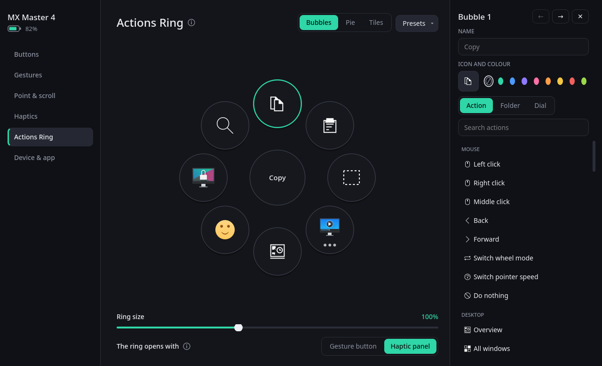

# MX Options

Програма налаштування мишей Logitech MX Master для Linux, зроблена за зразком Logi Options+:
кнопки, жести, кільце дій, коліщатка, вібровідгук і Easy-Switch, з іконкою в треї, фоновим
сервісом та D-Bus API для інших програм.

[English](README.md) — повна документація там.

> **Написано ШІ.** Увесь проєкт (код, інтерфейс, звуки, тести й ця документація) написав
> [Claude](https://claude.com/claude-code), ШІ-модель Anthropic, у Claude Code. Людина,
> [nictonus](https://github.com/nictonus),
> ставила задачі й перевіряла кожну збірку на справжній MX Master 4.

> **Неофіційна програма.** Не пов'язана з Logitech і не схвалена нею.



## Що вміє

- **Кнопки.** Середня, «назад», «вперед», кнопка жестів, кнопка режиму колеса й сенсорна панель:
  близько 70 готових дій (кожна робиться так, як це робить ваш робочий стіл), комбінації клавіш,
  команди, скрипти, макроси або сигнал іншій програмі.
- **Жести.** Чотири напрямки й натискання, живий компас, вибір моменту спрацювання, відстані в
  міліметрах, мертва зона діагоналей, свій візерунок вібрації на кожен момент жесту. Тією ж кнопкою
  можна малювати шістнадцять фігур (кути, туди й назад, кола, струси), кожна зі своєю дією. Додана
  програма може дати будь-якій кнопці власні жести на сторінці «Кнопки», зокрема панораму й масштаб
  під час утримання; як розпізнаються рухи, швидкість і вібрації — однакові в усіх програмах. Поки
  ви пробуєте жести на сторінці «Жести», діє програма, що була попереду перед MX Options, а компас
  показує жести для всіх програм. Поворот не пропонується.
- **Кільце дій.** Меню довкола курсора: бульбашки, пиріг або плитки. Бульбашка виконує дію,
  відкриває власне кільце або є регулятором, який крутиш колесом (гучність, вкладки, масштаб…).
  Курсор лишається вільним. Є готові пресети, свої можна зберігати.
- **Ефекти прожектора.** Утримуєш кнопку — і ефект іде за вказівником, доки її не відпустиш:
  *Підсвічування* затемнює екран довкола світлого кола, *Цифрова лазерна указка* — кольорова
  крапка, *Нерухома лупа* збільшує нерухомий знімок екрана, зроблений у мить натискання (власний
  різновид лупи цієї програми, не жива лупа). Кожен має свій розмір і колір; якщо ввімкнено кілька,
  двічі клацни й утримуй, щоб перейти до наступного. Поки що лише для кнопок у всіх програмах.
- **Коліщатка.** Швидкість вказівника, SmartShift, сила храповика, плавна прокрутка, функція
  бокового коліщатка і тік (вібрацією чи звуком), коли SmartShift відпускає та ловить колесо.
- **Вібровідгук.** Сила, вбудовані візерунки, сила натискання панелі. Вібрацію з ігор можна
  відтворювати на миші: див. [Вібрація з ігор](#вібрація-з-ігор).
- **Flow.** Одна миша на два чи три комп'ютери: проводиш вказівник за край екрана — і миша
  працює вже на комп'ютері за ним, разом зі скопійованим текстом, зображеннями й файлами.
  Комп'ютери спаровуються шестизначним кодом і спілкуються зашифровано. Див. [Flow](#flow).
- **Клавіатура.** Клавіатуру Logitech із HID++ 2.0 (MX Mechanical, MX Keys тощо) програма знаходить
  поруч із мишею, на тому самому приймачі або через Bluetooth, і показує під нею на бічній панелі:
  її програмовані клавіші отримують ті самі дії, що й кнопки, Easy-Switch із клавіші перемикає
  клавіатуру, а заряд, канали й прошивка видно. Незмінену клавішу програма не чіпає. На справжній
  клавіатурі ще не перевірено: див. [Обмеження](#обмеження).
- **Ще:** Easy-Switch, іконка в треї у п'яти стилях (прості беруть колір панелі й показують,
  що миші нема чи заряд низький; одна заповнюється разом із батареєю), чотири теми з будь-яким
  акцентом, українська та англійська. Усі налаштування можна експортувати у файл (до 1 МБ) і
  імпортувати знову: «Пристрій і програма → Файл налаштувань». У файлі є й ваші команди та
  скрипти, тож не показуйте його іншим; пар Flow у ньому немає. Перед імпортом поточні налаштування
  зберігаються в `~/.config/mxoptions/config.backup.json`.
  Редактор макросу експортує один макрос в окремий файл («Експортувати…») та імпортує його
  («Імпортувати…»). Формат власний, не файл Logitech Options+. Імпорт лише заповнює редактор:
  нічого не запускається й не зберігається до «Зберегти». Файл, що не є саме тим макросом, який
  редактор може показати, відхиляється цілком. Файл містить текст і команди макросу як є:
  не показуйте його іншим та імпортуйте лише файли, яким довіряєте.
- **Для інших програм:** [D-Bus API](docs/API.md).

## Що потрібно

Перевірено на **KDE Plasma 6 (Wayland)**, Arch-подібному дистрибутиві, з **MX Master 4 через
приймач Bolt**. Потрібні Python 3.12+ (для Flow 3.13+), PySide6 (системний, не з pip), python-evdev, layer-shell-qt
(маленька бібліотека, а не робочий стіл: вона потрібна і на sway чи Hyprland); numpy за бажанням. Щоб із Flow
переходило скопійоване — KGuiAddons із Python-прив'язками (KDE Frameworks 6) або wl-clipboard; на X11 не треба нічого.

Arch, CachyOS, Manjaro: `pyside6 python-evdev qt6-declarative qt6-multimedia layer-shell-qt python-numpy`

### Робочі столи

Усе, що стосується самої миші (кнопки, жести, колеса, швидкість вказівника, вібрація, Easy-Switch,
вібрація з ігор), від робочого столу не залежить. Те, що стосується столу, робиться так, як кожен стіл дозволяє:

| | KDE Plasma | sway, Hyprland та інші з layer-shell | GNOME на Wayland | Столи на X11 (Xfce, Cinnamon, MATE, i3, …) |
|---|---|---|---|---|
| Готові дії для вікон і столу | власні скорочення KDE: усі | `swaymsg`, `hyprctl`; запускач, скріншоти й термінал — із того, що встановлено (fuzzel, wofi, rofi; grim і slurp) | стандартні комбінації клавіш GNOME | звичні комбінації (Alt+F4, Ctrl+Alt+стрілки, Print, …) |
| Кільце дій | на шарі над вікнами | так само | у вікні на X-сервері сесії (XWayland), яке не забирає фокус; трохи м'якше там, де масштаб екрана дробовий | у вікні, якого менеджер вікон не чіпає; без композитора — панель розміром із кільце |
| Ефекти прожектора | підсвічування й лазерна указка, на шарі над вікнами | так само | підсвічування й лазерна указка, у вікні XWayland | усі три, де є композитор; без композитора — жодного |
| Flow: край екрана | скрипт KWin | прозора лінія в один піксель уздовж краю | неможливо: використовуйте дію «Перейти на інший комп'ютер (Flow)» | програма питає, де вказівник |
| Вібровідгук: імпульс при перемиканні екранів | той самий скрипт KWin | неможливо | неможливо | програма питає, де вказівник |
| Flow: скопійоване | KGuiAddons, інакше wl-clipboard | так само | wl-clipboard | сам Qt |

Дії, якої стіл не вміє, там у списках немає, а налаштування, зроблені в KDE, працюють далі: «Огляд»
лишається «Оглядом», просто робиться по-тутешньому. Комбінації клавіш — ті, з якими стіл постачається;
якщо ви їх перепризначили, дія не спрацює — тоді поставте замість неї свою комбінацію.

**Що справді запускалось.** Щодня програма працює лише на KDE Plasma 6 (Wayland). Шляхи для X11 (вікно
кільця, стеження за вказівником, визначення повноекранного вікна, буфер обміну) запускались у
віртуальному X-сервері без менеджера вікон. Лінію вздовж краю перевірено на KWin: вона чує вказівник і
передає далі кліки та прокрутку; там само перевірено кільце через XWayland — воно з'являється поверх
усього, з нього можна вибирати, а фокус лишається де був. На самих GNOME, sway, Hyprland чи будь-якому
столі X11 не запускалось нічого: їхні команди й комбінації взято з документації. Відгуки вітаються.

На GNOME кільце малює маленька друга програма (вона має говорити з X-сервером, чого головна, програма
Wayland, не може). Якщо сесія не тримає X-сервера, кільце відкривається у звичайному вікні, яке забирає
фокус, поки відкрите.

Змінні `MXOPTIONS_DESKTOP` (`kde`, `gnome`, `sway`, `hyprland`, `other`), `MXOPTIONS_RING` (`layer`, `x11`,
`xwayland`, `window`), `MXOPTIONS_FLOW_EDGES` (`kwin`, `poll`, `strips`, `none`) і `MXOPTIONS_CLIPBOARD` (`ksystem`,
`qt`, `wl-clipboard`, `klipper`, `none`) дають вибрати вручну, якщо програма визначила щось не так.

## Windows

Програма працює й на Windows (перевірено на 11, на 10 — ні). `python tools\build_windows.py` (з Python 3.13,
`pip install PySide6 numpy pyinstaller` та Inno Setup для третього пункту) збирає теку з `mxoptions.exe`,
zip і інсталятор `mxoptions-<версія>-setup.exe`. Інсталятор ставить програму у власну теку програм
користувача, прав адміністратора не просить, додає пункт у меню «Пуск» і, за бажанням, автозапуск; він же
оновлює й видаляє програму. Ні програма, ні інсталятор не підписані, тож першого разу Windows перепитає.
Із дерева коду програма запускається як `pythonw main.py`.

**Logi Options+ треба прибрати з дороги**, інакше дві програми скасовують налаштування одна одної. Його
агента щоразу піднімає його ж служба, тож зупиняти треба обох — із PowerShell адміністратора (до
наступного запуску Windows; або видалити Options+ назовсім):

```powershell
Stop-Service OptionsPlusUpdaterService; Stop-Process -Name logioptionsplus_agent, logioptionsplus_appbroker -Force
```

Якщо Options+ працює, MX Options пише про це у своєму вікні.

Що запускалось на Windows 11 з мишею по Bluetooth (керував з іншого комп'ютера, за мишею ніхто не сидів):

- програма — і з дерева коду, і зібрана — знаходить мишу, читає й задає заряд, швидкість вказівника,
  режим колеса, вібрацію та канал Easy-Switch;
- надсилає клавіші, текст, кліки й прокрутку; готові дії — рідними комбінаціями Windows;
- кільце відкривається біля вказівника, з нього можна вибирати, фокус лишається де був;
- вікно налаштувань малюється як на Linux; іконки, яких у Windows немає, беруться з її власного шрифту іконок;
- Flow з комп'ютером на Linux дією «Перейти на інший комп'ютер»: миша переходить туди й назад, а з нею
  текст, файли й теки (імена, яких Windows не може записати, змінюються мінімально). Комп'ютер із двома
  системами тримає одне спарювання на обидві;
- власні рух, кнопки й колесо миші читаються (через raw input) і відрізняються від інших маніпуляторів —
  на цьому тримається перехід через край екрана й тік при самостійній зміні режиму колеса;
- дії яскравості екрана керують власною панеллю ноутбука через драйвер дисплея, а також моніторами, які
  приймають це по кабелю (панель перевірено, такий монітор — ні);
- інсталятор встановлює, оновлює поверх запущеної копії й показує програму серед встановлених; «Запускати
  при вході» записує й прибирає свій запис;
- замість D-Bus, якого у Windows немає, — `mxoptions --call`.

**Вібрації з ігор у Windows потрібен драйвер.** Windows дає програмі додати ігровий контролер лише через
спеціальний драйвер; тут це [ViGEmBus](https://github.com/nefarius/ViGEmBus/releases), який ставиться один
раз (він більше не розвивається, але саме ним користуються такі програми). Збірка для Windows несе його
клієнтську бібліотеку (ViGEmClient.dll, ліцензія MIT; завантажується й перевіряється під час збирання).
Без драйвера налаштування так і кажуть. З ViGEmBus 1.22.0 це запускалось із тестовою програмою замість гри:
те, що вона через XInput надсилала моторам контролера, відтворювалось на миші. У самій грі не перевірялось.

Рукою на Windows перевірено: кнопки, жести, колеса, кільце дій і перехід через край екрана на комп'ютер
із Linux і назад. Не перевірено: приймач Bolt (написано, але його туди не вмикали), імпульс при
перемиканні екранів і вібрацію в самій грі.
Ще немає: щоб Flow знаходили інші комп'ютери (про це питає фаєрвол
Windows; бік Windows сам дзвонить іншому комп'ютеру, на що дозвіл не потрібен).

## Встановлення

Arch і похідні: завантаж пакет з [останнього релізу](https://github.com/nictonus/mxoptions/releases/latest) і встанови:

```sh
sudo pacman -U mxoptions-*-any.pkg.tar.zst
systemctl --user enable --now mxoptions.service
```

Будь-який дистрибутив, лише для себе, без root:

```sh
make install-user     # у ~/.local
make enable           # запустити зараз і при кожному вході
```

Без встановлення: `python3 main.py`.

Якщо програма не бачить мишу, встанови правила доступу: `sudo make udev`. Перед використанням
зупини **logid** і **Solaar**, бо дві програми перебивають налаштування одна одній.

### Windows

Візьміть `mxoptions-<версія>-setup.exe` з [релізів](https://github.com/nictonus/mxoptions/releases) і
запустіть: ставиться для вашого користувача, прав адміністратора не просить. Інсталятор не підписаний, тож
Windows перепитає («Докладніше» → «Усе одно запустити»). Спершу закрийте Logi Options+ — як саме і що вже
працює, а що ні, написано в розділі «Windows».

### Debian, Ubuntu, Fedora

Для Debian 13 та Ubuntu 25.04+ у [релізах](https://github.com/nictonus/mxoptions/releases) є
`.deb`: `sudo apt install ./mxoptions_*_all.deb`, далі `systemctl --user enable --now
mxoptions.service`. Той самий пакет збирається з джерел командою `make deb` (потрібен лише
Python). Для Fedora є `packaging/rpm/mxoptions.spec` під `rpmbuild`. Списки пакетів-залежностей
для обох — в англійському README. Пакет і spec зроблено на Arch за опублікованими списками
пакетів; на самих цих дистрибутивах автор їх не встановлював.

## Сервіс

Встановлена програма працює як користувацький сервіс systemd `mxoptions.service`:

```sh
systemctl --user status mxoptions
journalctl --user -u mxoptions -f
```

Вікно відкривається з меню програм або з трею. Перемикач «Запускати при вході» в налаштуваннях
вмикає й вимикає той самий сервіс.

Сервіс стартує разом із `graphical-session.target` systemd. KDE Plasma і GNOME доходять до нього самі.
Композитор, запущений сам по собі (sway, Hyprland, менеджер вікон із `.xinitrc`), — ні, якщо ви цього не
налаштували; там запускайте програму з конфігурації самого композитора:

```
exec mxoptions --background          # sway, i3
exec-once = mxoptions --background   # Hyprland
```

Без системного трею програмі нема де сидіти за своїм вікном: запущена у фоні, вона все одно працює, а
повторний запуск із меню відкриває вікно.

## Картинка миші

Справжній рендер MX Master 4 належить Logitech і до репозиторію не входить: програма завантажує
його з logitech.com, коли натиснеш «Завантажити» на сторінці «Кнопки». До того вона малює власну
3D-модель.

## Вібрація з ігор

Ігри вібрують геймпадами, а не мишами. Якщо ввімкнути «Вібровідгук → Вібрація з ігор», програма
додає в систему віртуальний геймпад (видно як контролер Xbox 360 з назвою «MX Options rumble
pad»). Вібрація, яку гра надсилає йому через SDL, Steam Input чи Proton, відтворюється мотором
миші.

- Мотор грає короткі візерунки, а не суцільне гудіння, тому вібрація стає низкою імпульсів: свій
  візерунок для слабкої, середньої та сильної вібрації, з вибраним проміжком.
- Гра при цьому бачить контролер. Деякі через це показують підказки для геймпада, а деякі
  вібрують лише тим контролером, яким справді грають, і тоді до миші нічого не дійде. Якщо гра
  поводиться дивно, вимкніть опцію — віртуальний геймпад зникне одразу.
- `journalctl --user -u mxoptions -f` показує «a game started vibrating», коли вібрація приходить:
  так видно, чи гра її взагалі надсилає.

Потрібна миша з вібромотором (MX Master 4). У справжній грі це ще не перевірялось.

## Інші миші

Перевірено на MX Master 4 (приймач Bolt і Bluetooth). Інші миші Logitech із HID++ 2.0 програма
приймає як є: показує те, що миша про себе повідомляє (кнопки, SmartShift старий чи новий, бокове
коліщатко, батарея), і ховає решту. Попередні MX Master (3S, 3, 2S, перша) малюються 3D-моделлю,
будь-яка інша миша — простим малюнком із її власними кнопками. Автор їх не пробував; користувач
повідомив, що жести працюють на Signature M650 L.

## Flow

Flow переводить мишу з одного комп'ютера на інший, коли вказівник проведено за край екрана, як
це робить Flow від Logitech, і забирає з собою скопійоване: текст, зображення, файли й теки. Це
власна реалізація: вона працює між комп'ютерами з MX Options, а не з Logi Options+. Комп'ютер
може мати сусіда з двох боків, тож три в ряд ділять одну мишу (у неї три канали Easy-Switch).
Із трьома це написано без третього комп'ютера під рукою: перевірено лише тестами на одній машині.

Що потрібно:

- MX Options на обох комп'ютерах, в одній мережі;
- миша спарена з обома на різних каналах Easy-Switch (приймач Bolt або Bluetooth);
- робочий стіл, що дає стежити за вказівником біля краю екрана: це всі, крім GNOME на Wayland
  (див. «Робочі столи»). Там, і де вам так зручніше, замість краю працює дія «Перейти на інший
  комп'ютер (Flow)» на кнопці, жесті чи бульбашці;
- щоб переходило скопійоване: KGuiAddons із Python-прив'язками або wl-clipboard на Wayland; на X11
  не треба нічого.

Налаштування, сторінка «Flow»:

1. На одному комп'ютері натисніть «Показати код». Він покаже шість цифр.
2. На іншому відкрийте ту саму сторінку. Він сам знайде перший комп'ютер і спитає код.
3. На малюнку клацніть, де стоїть інший комп'ютер. Той сам візьме протилежний бік.
4. Попрацюйте мишею на кожному комп'ютері по разу (перемкніть кнопкою Easy-Switch), щоб обидва
   запам'ятали свій канал. Далі переходьте через край екрана.

Що там можна підлаштувати:

- **Продавити за край:** скільки міліметрів ще треба вести мишу, коли вказівник уже біля краю
  (міряється на самій миші). На нулі досить дотику.
- **Не чіпати кути:** частка краю з кожного кінця, яка не веде на інший комп'ютер, щоб гарячі
  кути працювали як завжди.
- **Повноекранні вікна:** типово гра чи фільм на весь екран мишу не відпускають.
- **Лише із затиснутою Ctrl:** типово вимкнено. Коли ввімкнено, край переводить мишу лише тоді,
  коли затиснуто будь-яку з клавіш Ctrl; дії *Перейти на інший комп'ютер (Flow)* і кнопкам
  Easy-Switch це не потрібно. Працює в X11 і Windows (для Windows написано за документацією
  Microsoft, на комп'ютері з Windows ще не перевірено). Робочий стіл Wayland не каже програмі у
  фоні, чи затиснуто Ctrl, тож там, поки це ввімкнено, край лишає мишу тут; дія працює й далі.
  Старіші версії MX Options цього не знають і переходять без Ctrl.
- **Що переходить разом із мишею:** текст і зображення, файли й теки, найбільший обсяг за раз.
  Файли надсилаються під час переходу й добу чекають у `~/.cache/mxoptions/flow-files`. Буфер
  обміну комп'ютера, на який ви перейшли, не змінюється, доки не дійдуть усі; тоді миша дає
  вибрану вібрацію (іншу, якщо перенести не вдалося).
- **Призупинити один комп'ютер:** перемикач біля *Забути* на час виводить спарований комп'ютер із
  Flow, а спарювання й місце лишаються. Поки його призупинено, з'єднання з ним немає: миша не
  переходить на нього й назад, скопійоване не передається, клавіатура не йде слідом, а файли в
  дорозі зупиняються. Перемикання, що вже почалося до паузи, завершиться. Кнопки Easy-Switch і далі
  перемикають на нього. Щоб продовжити, увімкніть перемикач. Інший комп'ютер бачить його як не
  з'єднаний.

Як це працює і чим захищено:

- **Спарювання.** Шість цифр мережею не передаються. Комп'ютери виконують SRP-6a (RFC 5054,
  група 3072 біти, SHA-256) — обмін ключами з автентифікацією паролем: той, хто слухає чи стоїть
  посередині, не отримує нічого, на чому можна перебирати коди; хибний код коштує однієї з трьох
  спроб, а сам код дійсний дві хвилини й для одного комп'ютера. У підсумку в обох однаковий
  120-бітний ключ.
- **З'єднання.** Далі все йде через TLS 1.2 із цим ключем (ECDHE-PSK: записаний трафік не
  прочитати, навіть якщо ключ колись стане відомий).
- **Пошук один одного.** Маленькі UDP-розсилки в локальній мережі: комп'ютер, що показує код,
  повідомляє про це, а спаровані комп'ютери, які загубили один одного (змінилась адреса),
  гукають один одного з підписом своїм ключем. Адресу вводити не треба.
- **Порти.** TCP 47846 для з'єднання (`flow.port` у файлі налаштувань), UDP 47846 для пошуку,
  TCP 47847 лише поки показано код. Відкрийте їх у фаєрволі для іншого комп'ютера.
- **Перехід.** Комп'ютер, на якому миша, наказує їй змінити канал через HID++ і повідомляє
  іншому, де вказівник вийшов і що в буфері обміну. Той ставить свій вказівник у відповідне
  місце протилежного краю.

Миша йде на інший комп'ютер, лише коли з'єднання є і той повідомив свій канал, тож вона не
опиниться на вимкненому комп'ютері. Вона не йде, поки затиснуто кнопку або коли вказівник до краю
довів тачпад чи інша миша. Якщо миша все ж опинилась не на тому каналі, її поверне кнопка
Easy-Switch знизу.

**Миша йде за клавіатурою** (типово вимкнено; перемикач з'являється, щойно знайдено клавіатуру).
Натисніть власну клавішу Easy-Switch клавіатури для одного з інших комп'ютерів, і коли той
повідомить, що клавіатура прийшла, туди ж піде й миша. Це Flow від MX Options, між комп'ютерами,
де працює MX Options і видно клавіатуру; це не Logitech Flow і не Enhanced Easy-Switch з Logi
Options+, і їх ні про що не питають. Цей перемикач рухає лише мишу; клавіатуру рухає наступний.
Миша йде лише протягом 10 секунд після того, як клавіатура пішла, один раз за кожен її перехід, не
поки затиснуто кнопку і не тоді, коли клавіатуру відіслала дія цієї програми. Кожна пара називає
клавіатуру власним значенням, зробленим із ключа пари; яка це клавіатура, комп'ютер не покидає.

**Клавіатура йде за мишею** (типово вимкнено; перемикач з'являється, щойно знайдено клавіатуру).
Перешліть мишу на один з інших комп'ютерів, за край екрана чи дією, і туди ж піде клавіатура, на
той канал Easy-Switch, на якому її бачив той комп'ютер. Вона йде один раз за кожен перехід миші і
лише тоді, коли клавіатура тут, інший комп'ютер бачив цю саму клавіатуру відтоді, як запустився, і
вона там спарена, сама клавіатура каже, що цей канал спарено, і жодна клавіша не натиснута. Чи
натиснуто клавішу, питають у клавіатури перед самим переходом, через з'єднання, яке програма вже
має: відповідь одразу зводиться до одного «так» чи «ні», і з неї нічого не зберігається, не
пишеться в журнал і не надсилається. Інакше клавіатура лишається, а журнал каже чому («the keyboard
stays»; див. `journalctl --user -u mxoptions`). Для того самого переходу спроба не повторюється.

Почати це можна лише з Linux, коли клавіатура на Bluetooth (BlueZ). Клавіатура на приймачі чи
кабелі лишається, як і та, що повідомляє щось, крім клавіш (літер, мультимедійних і системних) та
своїх повідомлень HID++. Windows може прийняти клавіатуру, але не передати її далі сама: там
натисніть клавішу Easy-Switch клавіатури. Комп'ютерові, на який іде миша, теж потрібна ця версія,
щоб сказати, куди йти клавіатурі; зі старішою клавіатура лишається. Власні клавіші Easy-Switch
клавіатури працюють завжди, а вимкнений перемикач чи зупинена програма (`systemctl --user stop
mxoptions`) це припиняють.

Для мереж, де комп'ютери не можуть знайти один одного, адресу й ключ можна ввести вручну внизу
сторінки.

## Обмеження

- Ліву й праву кнопки перепризначити не можна: миша не дає їх перехопити.
- Автоматичне перемикання SmartShift миша не повідомляє, тому програма визначає його за швидкістю
  колеса; тік може розійтися на крок-два.
- Текст у макросах вставляється через буфер обміну, тому не працює в терміналах.
- Оновити прошивку поки нічим: програма показує версії й питає оновлення у fwupd, але Logitech не
  публікує прошивок для цієї миші та приймача Bolt під Linux. Сама програма нічого не прошиває.
- Програма запускалась на одному робочому столі — KDE Plasma (Wayland). Що вона робить на інших і що
  з цього запускалось, описано в розділі «Робочі столи». Там, де за краєм для Flow стежить лінія,
  перетягування, почате саме на цій лінії пікселів (смуга прокрутки біля краю екрана), не почнеться;
  клік і прокрутка передаються далі.
- Сенсорна панель не відповідає, поки затиснута основна кнопка: із затиснутою лівою миша про панель
  не повідомляє нічого, хоч як сильно тиснути, а про кнопку жестів повідомляє. Тож жести під час
  перетягування вікна краще лишити на кнопці жестів. Це видно з того, що шле сама миша.
- Усе перевірено на одній миші.
- Те, що миша йде за клавіатурою, на справжніх пристроях не пробували: це покривають лише тести з
  вигаданими комп'ютерами й клавіатурами. Якщо інший комп'ютер повідомить про клавіатуру раніше, ніж
  цей помітить, що вона пішла, миша лишається; як часто так буває, ще не відомо.
- Те, що клавіатура йде за мишею, на справжній клавіатурі не пробували: це покривають лише тести з
  вигаданими клавіатурами й комп'ютерами; чи справжня клавіатура правильно повідомляє через
  Bluetooth про натиснуту клавішу, ще не відомо. Клавіша, натиснута саме тієї миті, коли клавіатура
  перемикається, може лишитися натиснутою на комп'ютері, який вона покинула, і повторюватися, доки
  клавіатура не повернеться туди або клавішу не натиснуть знову. Якщо клавіатуру спарили наново
  після того, як інший комп'ютер бачив її востаннє, вона може опинитися на третьому комп'ютері; її
  клавіша Easy-Switch поверне її. Кожна перевірка читає клавіатуру через Bluetooth, а bluetoothd
  зберігає копію кожного читання (близько 8,5 КіБ) доки клавіатура під'єднана і повторює їх, коли
  вона під'єднується знову: тож програма читає клавіатуру щонайбільше 32 рази за кожне її відкриття
  і починає рахунок заново після перезапуску. З `UserspaceHID=persist` у `/etc/bluetooth/input.conf`
  ці копії переживають від'єднання, доки bluetoothd не перезапуститься. Поки перевірка чекає на
  відповідь клавіатури, інші програми, що відкривають чи закривають пристрій HID, теж можуть чекати,
  зрідка до 5 секунд.
- Клавіатурну частину ще не пробували на клавіатурі: її написано за опублікованим описом протоколу
  Logitech і перевірено лише тестами з вигаданими пристроями. Що справжня клавіатура робить зі
  зміненою клавішею після збою, вимкнення живлення чи Easy-Switch на комп'ютер без MX Options, ще
  не бачили; доти вважайте її попередньою версією.
- Одна клавіатура за раз: другу програма не бере, поки є перша.
- Клавіші Easy-Switch і клавіші шару Fn програма не перехоплює; режим Fn, підсвічування та інші
  налаштування самої клавіатури поки не пропонуються. Сторінка «Клавіатура» перелічує ті, які,
  за словами клавіатури, вона має, загальними словами: це не каже, які клавіші чи значення вона для
  них використовує, і програма жодного з них не змінює.
- Версію прошивки клавіатури програма читає з самої клавіатури, якщо fwupd її не показує, після
  налаштування клавіш. Чи збігається вона з версією, яку показує власна програма Logitech, на
  справжній клавіатурі не перевіряли.
- Змінені клавіші повертаються, коли програма завершує роботу: клавішу змінено тимчасовим
  налаштуванням клавіатури, ніколи постійним. Перед зміною програма записує клавішу у
  `~/.local/share/mxoptions/keyboard-diverted.json`, а після збою наступного запуску повертає те,
  що досі змінене. Клавіші, змінені іншою програмою, вона не чіпає, а поки працює Logi Options+,
  Solaar чи logiops, не чіпає жодної. Якщо цей файл не читається, теж нічого не чіпає: приберіть
  його, а якщо клавіша й далі не працює, один раз вимкніть і ввімкніть клавіатуру. Старіша версія MX Options клавіатурних
  налаштувань і цього файлу не бачить; перед поверненням до неї закрийте цю, щоб клавіші
  повернулися. «Відновити типові» у старішій версії стирає налаштування клавіатури.
- Ефекти прожектора — лише перша частина. Їх задають для кнопки в усіх програмах, не для клавіші й
  не в профілі програми. Поки ефект видно, він накриває свій екран (з XWayland — усі екрани):
  клацання й прокрутка там нічого не роблять, доки кнопку не відпущено, зокрема прокрутка й
  масштаб бічного колеса; клавіші й функції бічного колеса, які надсилають клавіші, працюють як
  завжди. Нерухома лупа показує екран таким, яким він був у мить натискання: знімок лише в пам'яті
  (щонайбільше 64 МіБ), який зникає після відпускання. На Wayland її немає: там програма не отримує
  знімка екрана, не спитавши, а живої лупи ще немає. Без композитора на X11 і на стільницях Wayland
  без layer-shell і без XWayland ефектів немає взагалі. Поки кнопку прожектора утримано, кільце не
  відкривається. На справжній стільниці це ще не пробували: його покривають тести з вигаданими
  екранами й знімками.
- Запропоновані налаштування для програми — лише перша частина. На сторінці «Кнопки» додана програма
  може взяти один із трьох наборів за зразком Logi Options+: «Веббраузер» (середня кнопка, «Назад» і
  «Вперед» — як у самої миші, бічне колесо перемикає вкладки), «Електронна таблиця» («Назад» —
  Ctrl+Z, «Вперед» — Ctrl+Y, бічне колесо прокручує вбік) і «Документи й слайди» (ті самі кнопки,
  бічне колесо змінює масштаб). Набір змінює лише те, що в програмі як в усіх програмах; власна
  кнопка чи функція лишається, і вікно перед застосуванням показує і те, і те. У таблицях і
  документах Logi Options+ ще й прокручує сторінку, поки утримано середню кнопку: ці набори лишають
  середню кнопку як є (середній кнопці програми можна вручну дати «Жести» з «Панорамою»), і немає
  наборів для Photoshop, Premiere Pro, Final Cut Pro, Zoom і Teams та кілець для окремих програм.
  Програму не впізнають за назвою. Ctrl+Z і Ctrl+Y — це місця клавіш: у розкладці, де Z і Y
  помінялися місцями (наприклад, німецькій), міняються й вони.
  Ще два набори — власний вибір, а не за зразком Logi Options+ (що в її наборах для Zoom і Teams, не
  опубліковано): «Зустрічі в Zoom» (Linux і Windows: «Назад» — Alt+A, вимкнути чи ввімкнути звук,
  «Вперед» — Alt+V, увімкнути чи вимкнути відео; стандартні скорочення Zoom на зустрічі) і, лише у
  Windows, «Зустрічі в Microsoft Teams» (Ctrl+Shift+M і Ctrl+Shift+O програми Teams для комп'ютера;
  для Linux такої програми немає, а вебпрограма не має скорочення для відео). Вони змінюють лише
  кнопки «Назад» і «Вперед». Кожне натискання надсилає скорочення один раз, хоч як довго кнопку
  утримано, і лише поки ця програма на передньому плані. Як будь-який макрос, воно чекає на макрос,
  що ще грає; чекати можуть щонайбільше чотири, натискання понад це відкидається, а зміна того, що
  робить кнопка, або відключення миші відкидає те, що ще чекає. Скорочення, змінене в програмі, вже
  не збігається. Клавіші — це місця клавіш: на французькій AZERTY Alt+A потрапляє туди, де Q, а
  Microsoft наводить свої скорочення для розкладки США. Це вимкнення звуку в самій програмі, а не
  системне «Вимкнути мікрофон» (`mic_mute`), яке лишається окремою дією. З самими програмами ще не
  пробували.
  У Windows є ще два власні набори, «Photoshop» і «Premiere». Це частковий власний вибір за клавішами
  Windows, які описує Adobe, а не названі вище набори Logi Options+ для цих програм: що надсилають
  ті, тут не відомо, тож їх і далі немає. «Photoshop»: «Назад» — Ctrl+Z, «Вперед» — Ctrl+Shift+Z,
  бічне колесо — `]` обертанням угору і `[` обертанням униз; Adobe називає їх для розміру пензля в
  Pattern Stamp і Spot Healing Brush. «Premiere»: ті самі кнопки, бічне колесо — Page Down і Page Up:
  наступний і попередній екран Timeline, цілий екран за крок, а не плавна прокрутка; Adobe каже, що
  вказівник має бути над Timeline, а її список клавіш — що панель має бути у фокусі. Adobe випускає
  ці програми лише для Windows і macOS, тож інші системи цих двох наборів не пропонують; задане ними
  лишається звичайними налаштуваннями програми скрізь. Комбінації бічного колеса вони дають лише там,
  де в програми немає власних і її бічне колесо надсилає комбінації; власні комбінації програми
  лишаються, і вікно їх називає. Змінені в програмі клавіші, інша розкладка чи «Use Legacy Undo
  Shortcuts» у Photoshop змусять їх робити інше. З Photoshop і Premiere їх не випробовували.
- Дії Photoshop на кільці (Windows), ваше власне налаштування. Photoshop відтворює записану дію за
  функціональною клавішею, яку ви їй дасте. Запишіть дію на його панелі Actions (скажімо, Layer > New
  Adjustment Layer > Brightness/Contrast), дайте їй Function Key, наприклад Ctrl+Shift+F3, а тоді
  дайте цю клавішу як комбінацію клавіш бульбашці власного кільця Photoshop. Кожне натискання
  бульбашки відтворює дію один раз. Це ваше налаштування тим, що програма вже має, а не вбудований
  регулятор Photoshop: обертати регулятор, щоб змінювати значення (яскравість, насиченість), так не
  вийде, і цього ще не зроблено. Кільця з F-клавішами програма не дає: вона не може знати, які дії ви
  записали.
- Easy-Switch з клавіші спершу повертає клавіші: клавіатуру перемкнуто на інший комп’ютер лише тоді,
  коли кожна змінена програмою клавіша знову звичайна; якщо якусь повернути не вдалося, клавіатура
  лишається тут із клавішами як налаштовано, і сторінка «Клавіатура» про це каже. Власні клавіші
  Easy-Switch клавіатури належать їй: коли ними користуються, програму не питають.

## Ліцензія

[MIT](LICENSE).
