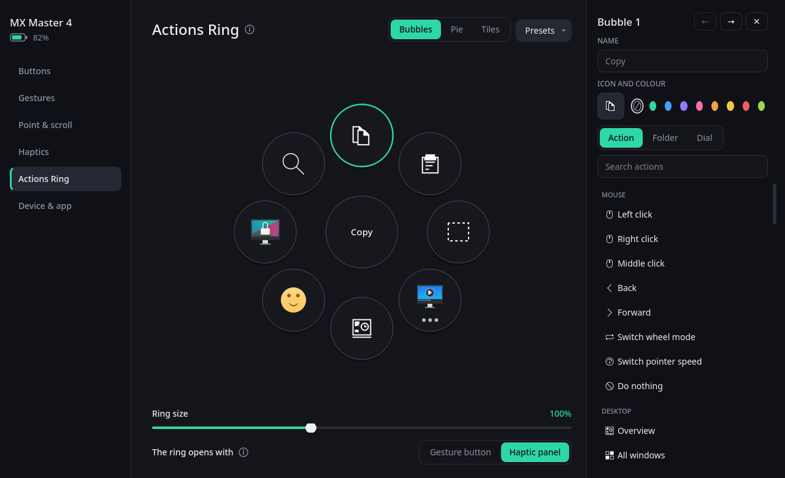

# MX Options

Програма налаштування мишей Logitech MX Master для Linux, зроблена за зразком Logi Options+:
кнопки, жести, кільце дій, коліщатка, вібровідгук і Easy-Switch, з іконкою в треї, фоновим
сервісом та D-Bus API для інших програм.

[English](README.md) — повна документація там.

> **Написано ШІ.** Увесь проєкт (код, інтерфейс, звуки, тести й ця документація) написав
> [Claude](https://claude.com/claude-code), ШІ-модель Anthropic, у Claude Code. Людина,
> [nictonus](https://github.com/nictonus),
> ставила задачі й перевіряла кожну збірку на справжній MX Master 4.

> **Неофіційна програма.** Не пов'язана з Logitech і не схвалена нею.



## Що вміє

- **Кнопки.** Середня, «назад», «вперед», кнопка жестів, кнопка режиму колеса й сенсорна панель:
  близько 70 готових дій (кожна робиться так, як це робить ваш робочий стіл), комбінації клавіш,
  команди, скрипти, макроси або сигнал іншій програмі.
- **Жести.** Чотири напрямки й натискання, живий компас, вибір моменту спрацювання, відстані в
  міліметрах, мертва зона діагоналей, свій візерунок вібрації на кожен момент жесту. Тією ж
  кнопкою можна малювати шістнадцять фігур (кути, туди й назад, кола, струси), кожна зі своєю дією.
- **Кільце дій.** Меню довкола курсора: бульбашки, пиріг або плитки. Бульбашка виконує дію,
  відкриває власне кільце або є регулятором, який крутиш колесом (гучність, вкладки, масштаб…).
  Курсор лишається вільним. Є готові пресети, свої можна зберігати.
- **Коліщатка.** Швидкість вказівника, SmartShift, сила храповика, плавна прокрутка, функція
  бокового коліщатка і тік (вібрацією чи звуком), коли SmartShift відпускає та ловить колесо.
- **Вібровідгук.** Сила, вбудовані візерунки, сила натискання панелі. Вібрацію з ігор можна
  відтворювати на миші: див. [Вібрація з ігор](#вібрація-з-ігор).
- **Flow.** Одна миша на два чи три комп'ютери: проводиш вказівник за край екрана — і миша
  працює вже на комп'ютері за ним, разом зі скопійованим текстом, зображеннями й файлами.
  Комп'ютери спаровуються шестизначним кодом і спілкуються зашифровано. Див. [Flow](#flow).
- **Ще:** Easy-Switch, іконка в треї у п'яти стилях (прості беруть колір панелі й показують,
  що миші нема чи заряд низький; одна заповнюється разом із батареєю), чотири теми з будь-яким
  акцентом, українська та англійська.
- **Для інших програм:** [D-Bus API](docs/API.md).

## Що потрібно

Перевірено на **KDE Plasma 6 (Wayland)**, Arch-подібному дистрибутиві, з **MX Master 4 через
приймач Bolt**. Потрібні Python 3.12+ (для Flow 3.13+), PySide6 (системний, не з pip), python-evdev, layer-shell-qt
(маленька бібліотека, а не робочий стіл: вона потрібна і на sway чи Hyprland); numpy за бажанням. Щоб із Flow
переходило скопійоване — KGuiAddons із Python-прив'язками (KDE Frameworks 6) або wl-clipboard; на X11 не треба нічого.

Arch, CachyOS, Manjaro: `pyside6 python-evdev qt6-declarative qt6-multimedia layer-shell-qt python-numpy`

### Робочі столи

Усе, що стосується самої миші (кнопки, жести, колеса, швидкість вказівника, вібрація, Easy-Switch,
вібрація з ігор), від робочого столу не залежить. Те, що стосується столу, робиться так, як кожен стіл дозволяє:

| | KDE Plasma | sway, Hyprland та інші з layer-shell | GNOME на Wayland | Столи на X11 (Xfce, Cinnamon, MATE, i3, …) |
|---|---|---|---|---|
| Готові дії для вікон і столу | власні скорочення KDE: усі | `swaymsg`, `hyprctl`; запускач, скріншоти й термінал — із того, що встановлено (fuzzel, wofi, rofi; grim і slurp) | стандартні комбінації клавіш GNOME | звичні комбінації (Alt+F4, Ctrl+Alt+стрілки, Print, …) |
| Кільце дій | на шарі над вікнами | так само | у вікні на X-сервері сесії (XWayland), яке не забирає фокус; трохи м'якше там, де масштаб екрана дробовий | у вікні, якого менеджер вікон не чіпає; без композитора — панель розміром із кільце |
| Flow: край екрана | скрипт KWin | прозора лінія в один піксель уздовж краю | неможливо: використовуйте дію «Перейти на інший комп'ютер (Flow)» | програма питає, де вказівник |
| Flow: скопійоване | KGuiAddons, інакше wl-clipboard | так само | wl-clipboard | сам Qt |

Дії, якої стіл не вміє, там у списках немає, а налаштування, зроблені в KDE, працюють далі: «Огляд»
лишається «Оглядом», просто робиться по-тутешньому. Комбінації клавіш — ті, з якими стіл постачається;
якщо ви їх перепризначили, дія не спрацює — тоді поставте замість неї свою комбінацію.

**Що справді запускалось.** Щодня програма працює лише на KDE Plasma 6 (Wayland). Шляхи для X11 (вікно
кільця, стеження за вказівником, визначення повноекранного вікна, буфер обміну) запускались у
віртуальному X-сервері без менеджера вікон. Лінію вздовж краю перевірено на KWin: вона чує вказівник і
передає далі кліки та прокрутку; там само перевірено кільце через XWayland — воно з'являється поверх
усього, з нього можна вибирати, а фокус лишається де був. На самих GNOME, sway, Hyprland чи будь-якому
столі X11 не запускалось нічого: їхні команди й комбінації взято з документації. Відгуки вітаються.

На GNOME кільце малює маленька друга програма (вона має говорити з X-сервером, чого головна, програма
Wayland, не може). Якщо сесія не тримає X-сервера, кільце відкривається у звичайному вікні, яке забирає
фокус, поки відкрите.

Змінні `MXOPTIONS_DESKTOP` (`kde`, `gnome`, `sway`, `hyprland`, `other`), `MXOPTIONS_RING` (`layer`, `x11`,
`xwayland`, `window`), `MXOPTIONS_FLOW_EDGES` (`kwin`, `poll`, `strips`, `none`) і `MXOPTIONS_CLIPBOARD` (`ksystem`,
`qt`, `wl-clipboard`, `klipper`, `none`) дають вибрати вручну, якщо програма визначила щось не так.

## Windows (у роботі)

Програму переносять на Windows. `python tools\build_windows.py` (з Python 3.13,
`pip install PySide6 numpy pyinstaller` та Inno Setup для третього пункту) збирає теку з `mxoptions.exe`,
zip і інсталятор `mxoptions-<версія>-setup.exe`. Інсталятор ставить програму у власну теку програм
користувача, прав адміністратора не просить, додає пункт у меню «Пуск» і, за бажанням, автозапуск; він же
оновлює й видаляє програму. Ні програма, ні інсталятор не підписані, тож першого разу Windows перепитає.
Із дерева коду програма запускається як `pythonw main.py`.

**Logi Options+ треба прибрати з дороги**, інакше дві програми скасовують налаштування одна одної. Його
агента щоразу піднімає його ж служба, тож зупиняти треба обох — із PowerShell адміністратора (до
наступного запуску Windows; або видалити Options+ назовсім):

```powershell
Stop-Service OptionsPlusUpdaterService; Stop-Process -Name logioptionsplus_agent, logioptionsplus_appbroker -Force
```

Якщо Options+ працює, MX Options пише про це у своєму вікні.

Що запускалось на Windows 11 з мишею по Bluetooth (керував з іншого комп'ютера, за мишею ніхто не сидів):

- програма — і з дерева коду, і зібрана — знаходить мишу, читає й задає заряд, швидкість вказівника,
  режим колеса, вібрацію та канал Easy-Switch;
- надсилає клавіші, текст, кліки й прокрутку; готові дії — рідними комбінаціями Windows;
- кільце відкривається біля вказівника, з нього можна вибирати, фокус лишається де був;
- вікно налаштувань малюється як на Linux; іконки, яких у Windows немає, беруться з її власного шрифту іконок;
- Flow з комп'ютером на Linux дією «Перейти на інший комп'ютер»: миша переходить туди й назад, а з нею
  текст, файли й теки (імена, яких Windows не може записати, змінюються мінімально). Комп'ютер із двома
  системами тримає одне спарювання на обидві;
- власні рух, кнопки й колесо миші читаються (через raw input) і відрізняються від інших маніпуляторів —
  на цьому тримається перехід через край екрана й тік при самостійній зміні режиму колеса;
- дії яскравості екрана керують власною панеллю ноутбука через драйвер дисплея, а також моніторами, які
  приймають це по кабелю (панель перевірено, такий монітор — ні);
- інсталятор встановлює, оновлює поверх запущеної копії й показує програму серед встановлених; «Запускати
  при вході» записує й прибирає свій запис;
- замість D-Bus, якого у Windows немає, — `mxoptions --call`.

**Вібрації з ігор у Windows потрібен драйвер.** Windows дає програмі додати ігровий контролер лише через
спеціальний драйвер; тут це [ViGEmBus](https://github.com/nefarius/ViGEmBus/releases), який ставиться один
раз (він більше не розвивається, але саме ним користуються такі програми). Збірка для Windows несе його
клієнтську бібліотеку (ViGEmClient.dll, ліцензія MIT; завантажується й перевіряється під час збирання).
Без драйвера налаштування так і кажуть; з ним вібрація з ігор ще не запускалась.

Не перевірено, бо потрібна рука на миші: самі кнопки, жести й колеса (код той самий, що на Linux) і
проштовхування вказівника за край екрана. Теж не перевірено: приймач Bolt (написано, але його туди не
вмикали) і вібрація з ігор (див. вище). Ще немає: щоб Flow знаходили інші комп'ютери (про це питає фаєрвол
Windows; бік Windows сам дзвонить іншому комп'ютеру, на що дозвіл не потрібен).

## Встановлення

Arch і похідні: завантаж пакет з [останнього релізу](https://github.com/nictonus/mxoptions/releases/latest) і встанови:

```sh
sudo pacman -U mxoptions-*-any.pkg.tar.zst
systemctl --user enable --now mxoptions.service
```

Будь-який дистрибутив, лише для себе, без root:

```sh
make install-user     # у ~/.local
make enable           # запустити зараз і при кожному вході
```

Без встановлення: `python3 main.py`.

Якщо програма не бачить мишу, встанови правила доступу: `sudo make udev`. Перед використанням
зупини **logid** і **Solaar**, бо дві програми перебивають налаштування одна одній.

### Windows

Візьміть `mxoptions-<версія>-setup.exe` з [релізів](https://github.com/nictonus/mxoptions/releases) і
запустіть: ставиться для вашого користувача, прав адміністратора не просить. Інсталятор не підписаний, тож
Windows перепитає («Докладніше» → «Усе одно запустити»). Спершу закрийте Logi Options+ — як саме і що вже
працює, а що ні, написано в розділі «Windows (у роботі)».

### Debian, Ubuntu, Fedora

Для Debian 13 та Ubuntu 25.04+ у [релізах](https://github.com/nictonus/mxoptions/releases) є
`.deb`: `sudo apt install ./mxoptions_*_all.deb`, далі `systemctl --user enable --now
mxoptions.service`. Той самий пакет збирається з джерел командою `make deb` (потрібен лише
Python). Для Fedora є `packaging/rpm/mxoptions.spec` під `rpmbuild`. Списки пакетів-залежностей
для обох — в англійському README. Пакет і spec зроблено на Arch за опублікованими списками
пакетів; на самих цих дистрибутивах автор їх не встановлював.

## Сервіс

Встановлена програма працює як користувацький сервіс systemd `mxoptions.service`:

```sh
systemctl --user status mxoptions
journalctl --user -u mxoptions -f
```

Вікно відкривається з меню програм або з трею. Перемикач «Запускати при вході» в налаштуваннях
вмикає й вимикає той самий сервіс.

Сервіс стартує разом із `graphical-session.target` systemd. KDE Plasma і GNOME доходять до нього самі.
Композитор, запущений сам по собі (sway, Hyprland, менеджер вікон із `.xinitrc`), — ні, якщо ви цього не
налаштували; там запускайте програму з конфігурації самого композитора:

```
exec mxoptions --background          # sway, i3
exec-once = mxoptions --background   # Hyprland
```

Без системного трею програмі нема де сидіти за своїм вікном: запущена у фоні, вона все одно працює, а
повторний запуск із меню відкриває вікно.

## Картинка миші

Справжній рендер MX Master 4 належить Logitech і до репозиторію не входить: програма завантажує
його з logitech.com, коли натиснеш «Завантажити» на сторінці «Кнопки». До того вона малює власну
3D-модель.

## Вібрація з ігор

Ігри вібрують геймпадами, а не мишами. Якщо ввімкнути «Вібровідгук → Вібрація з ігор», програма
додає в систему віртуальний геймпад (видно як контролер Xbox 360 з назвою «MX Options rumble
pad»). Вібрація, яку гра надсилає йому через SDL, Steam Input чи Proton, відтворюється мотором
миші.

- Мотор грає короткі візерунки, а не суцільне гудіння, тому вібрація стає низкою імпульсів: свій
  візерунок для слабкої, середньої та сильної вібрації, з вибраним проміжком.
- Гра при цьому бачить контролер. Деякі через це показують підказки для геймпада, а деякі
  вібрують лише тим контролером, яким справді грають, і тоді до миші нічого не дійде. Якщо гра
  поводиться дивно, вимкніть опцію — віртуальний геймпад зникне одразу.
- `journalctl --user -u mxoptions -f` показує «a game started vibrating», коли вібрація приходить:
  так видно, чи гра її взагалі надсилає.

Потрібна миша з вібромотором (MX Master 4). У справжній грі це ще не перевірялось.

## Інші миші

Перевірено на MX Master 4 (приймач Bolt і Bluetooth). Інші миші Logitech із HID++ 2.0 програма
приймає як є: показує те, що миша про себе повідомляє (кнопки, SmartShift старий чи новий, бокове
коліщатко, батарея), і ховає решту. Попередні MX Master (3S, 3, 2S, перша) малюються 3D-моделлю,
будь-яка інша миша — простим малюнком із її власними кнопками. Автор їх не пробував; користувач
повідомив, що жести працюють на Signature M650 L.

## Flow

Flow переводить мишу з одного комп'ютера на інший, коли вказівник проведено за край екрана, як
це робить Flow від Logitech, і забирає з собою скопійоване: текст, зображення, файли й теки. Це
власна реалізація: вона працює між комп'ютерами з MX Options, а не з Logi Options+. Комп'ютер
може мати сусіда з двох боків, тож три в ряд ділять одну мишу (у неї три канали Easy-Switch).
Із трьома це написано без третього комп'ютера під рукою: перевірено лише тестами на одній машині.

Що потрібно:

- MX Options на обох комп'ютерах, в одній мережі;
- миша спарена з обома на різних каналах Easy-Switch (приймач Bolt або Bluetooth);
- робочий стіл, що дає стежити за вказівником біля краю екрана: це всі, крім GNOME на Wayland
  (див. «Робочі столи»). Там, і де вам так зручніше, замість краю працює дія «Перейти на інший
  комп'ютер (Flow)» на кнопці, жесті чи бульбашці;
- щоб переходило скопійоване: KGuiAddons із Python-прив'язками або wl-clipboard на Wayland; на X11
  не треба нічого.

Налаштування, сторінка «Flow»:

1. На одному комп'ютері натисніть «Показати код». Він покаже шість цифр.
2. На іншому відкрийте ту саму сторінку. Він сам знайде перший комп'ютер і спитає код.
3. На малюнку клацніть, де стоїть інший комп'ютер. Той сам візьме протилежний бік.
4. Попрацюйте мишею на кожному комп'ютері по разу (перемкніть кнопкою Easy-Switch), щоб обидва
   запам'ятали свій канал. Далі переходьте через край екрана.

Що там можна підлаштувати:

- **Продавити за край:** скільки міліметрів ще треба вести мишу, коли вказівник уже біля краю
  (міряється на самій миші). На нулі досить дотику.
- **Не чіпати кути:** частка краю з кожного кінця, яка не веде на інший комп'ютер, щоб гарячі
  кути працювали як завжди.
- **Повноекранні вікна:** типово гра чи фільм на весь екран мишу не відпускають.
- **Що переходить разом із мишею:** текст і зображення, файли й теки, найбільший обсяг за раз.
  Файли надсилаються під час переходу й добу чекають у `~/.cache/mxoptions/flow-files`. Буфер
  обміну комп'ютера, на який ви перейшли, не змінюється, доки не дійдуть усі; тоді миша дає
  вибрану вібрацію (іншу, якщо перенести не вдалося).

Як це працює і чим захищено:

- **Спарювання.** Шість цифр мережею не передаються. Комп'ютери виконують SRP-6a (RFC 5054,
  група 3072 біти, SHA-256) — обмін ключами з автентифікацією паролем: той, хто слухає чи стоїть
  посередині, не отримує нічого, на чому можна перебирати коди; хибний код коштує однієї з трьох
  спроб, а сам код дійсний дві хвилини й для одного комп'ютера. У підсумку в обох однаковий
  120-бітний ключ.
- **З'єднання.** Далі все йде через TLS 1.2 із цим ключем (ECDHE-PSK: записаний трафік не
  прочитати, навіть якщо ключ колись стане відомий).
- **Пошук один одного.** Маленькі UDP-розсилки в локальній мережі: комп'ютер, що показує код,
  повідомляє про це, а спаровані комп'ютери, які загубили один одного (змінилась адреса),
  гукають один одного з підписом своїм ключем. Адресу вводити не треба.
- **Порти.** TCP 47846 для з'єднання (`flow.port` у файлі налаштувань), UDP 47846 для пошуку,
  TCP 47847 лише поки показано код. Відкрийте їх у фаєрволі для іншого комп'ютера.
- **Перехід.** Комп'ютер, на якому миша, наказує їй змінити канал через HID++ і повідомляє
  іншому, де вказівник вийшов і що в буфері обміну. Той ставить свій вказівник у відповідне
  місце протилежного краю.

Миша йде на інший комп'ютер, лише коли з'єднання є і той повідомив свій канал, тож вона не
опиниться на вимкненому комп'ютері. Вона не йде, поки затиснуто кнопку або коли вказівник до краю
довів тачпад чи інша миша. Якщо миша все ж опинилась не на тому каналі, її поверне кнопка
Easy-Switch знизу.

Клавіатура за мишею не переходить, якщо її не перемикати інакше. Для мереж, де комп'ютери не
можуть знайти один одного, адресу й ключ можна ввести вручну внизу сторінки.

## Обмеження

- Ліву й праву кнопки перепризначити не можна: миша не дає їх перехопити.
- Автоматичне перемикання SmartShift миша не повідомляє, тому програма визначає його за швидкістю
  колеса; тік може розійтися на крок-два.
- Текст у макросах вставляється через буфер обміну, тому не працює в терміналах.
- Оновити прошивку поки нічим: програма показує версії й питає оновлення у fwupd, але Logitech не
  публікує прошивок для цієї миші та приймача Bolt під Linux. Сама програма нічого не прошиває.
- Програма запускалась на одному робочому столі — KDE Plasma (Wayland). Що вона робить на інших і що
  з цього запускалось, описано в розділі «Робочі столи». Там, де за краєм для Flow стежить лінія,
  перетягування, почате саме на цій лінії пікселів (смуга прокрутки біля краю екрана), не почнеться;
  клік і прокрутка передаються далі.
- Сенсорна панель не відповідає, поки затиснута основна кнопка: із затиснутою лівою миша про панель
  не повідомляє нічого, хоч як сильно тиснути, а про кнопку жестів повідомляє. Тож жести під час
  перетягування вікна краще лишити на кнопці жестів. Це видно з того, що шле сама миша.
- Усе перевірено на одній миші.

## Ліцензія

[MIT](LICENSE).
